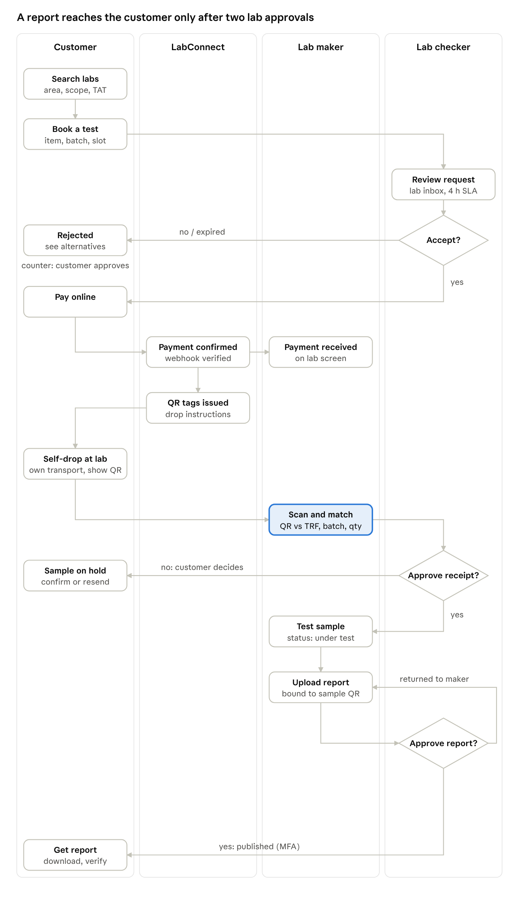
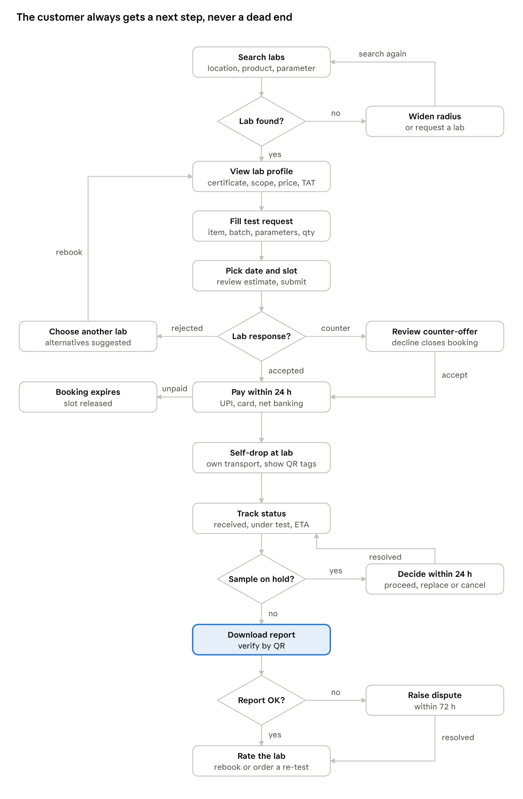
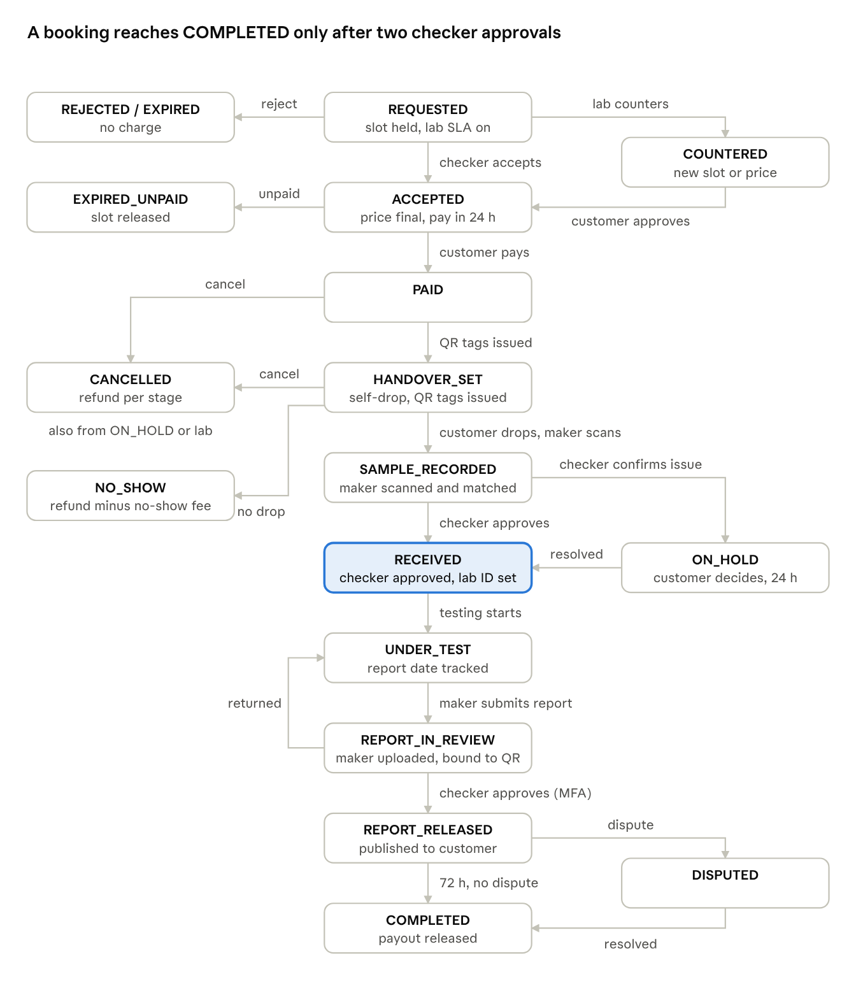
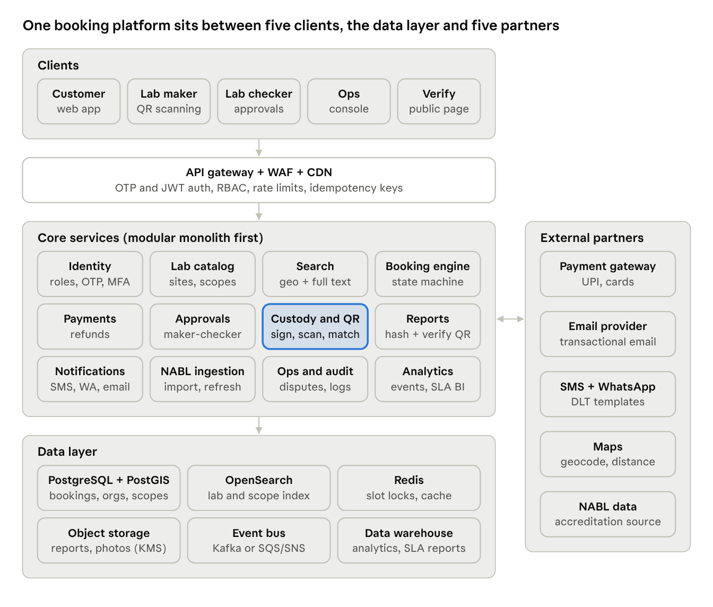

> **Source document (read-only).** This is the LabConnect Feature Specification v1.0 (draft, Oct 2026), converted from .docx. Where it conflicts with the rest of `docs/`, see `SOURCE_RECONCILIATION.md` and the precedence rules in `CLAUDE.md` §4. Don't edit it. Record changes in the decision register instead.

# LabConnect: Lab Marketplace — Feature Specification

Oct 30, 2026 · @Virendra Kumar

## Specification Amendment: MVP Scope, Customer-Managed Sample Transportation

This amendment takes precedence over any pickup, rider, delivery-partner
or logistics content elsewhere in this document. The rest of this
document has been aligned with it: there is no rider, pickup or
delivery-partner role in the MVP, and labs have exactly two login types,
Maker and Checker.

### A.1 Revised MVP principle

The MVP will support only **customer self-drop at the selected
laboratory**. The customer is responsible for arranging and managing
transportation of the sample to the laboratory.

LabConnect will facilitate the digital handover process through booking
details, sample/package QR codes, drop instructions, and laboratory
receipt confirmation. It will not provide or manage transportation
services.

### A.2 Revised customer journey

The revised end-to-end journey is:

**Discover → Select Lab → Submit Testing Request → Lab Accepts/Rejects →
Customer Pays → Customer Arranges Transportation → Customer Self-Drops
Sample at Lab → Lab Verifies Sample → Testing → Report Release → Report
Verification → Settlement**

After payment:

1.  The customer receives the laboratory's address, receiving hours,
    contact details, and sample submission instructions.

2.  LabConnect generates a booking QR code and unique QR codes for each
    declared package.

3.  The customer arranges transportation independently and brings the
    sample to the selected laboratory.

4.  The customer presents the booking/package QR code at the laboratory.

5.  The Lab Maker scans the QR code and verifies the booking, material,
    batch details, expected package count, and sample condition.

6.  The Lab Maker submits the receipt record; the Lab Checker approves
    acceptance or confirms a discrepancy through the platform.

7.  Once accepted, the sample moves into the testing workflow.

### A.3 Revised functional requirements: sample handover (FR-LOG)

| ID        | Requirement                                                                                                                                                                                       | Priority |
|-----------|---------------------------------------------------------------------------------------------------------------------------------------------------------------------------------------------------|----------|
| FR-LOG-01 | The MVP shall support only customer self-drop. The customer is responsible for arranging and managing transportation of samples to the selected laboratory.                                       | Must     |
| FR-LOG-02 | After successful payment, the platform shall display the laboratory address, location, receiving hours, contact details, sample submission instructions, and drop deadline.                       | Must     |
| FR-LOG-03 | The platform shall generate a booking QR code and a unique QR code for every declared package.                                                                                                    | Must     |
| FR-LOG-04 | The customer shall be able to view and download the QR codes and sample submission instructions.                                                                                                  | Must     |
| FR-LOG-05 | The customer shall present the booking/package QR code when physically submitting the sample at the laboratory.                                                                                   | Must     |
| FR-LOG-06 | The Lab Maker shall scan the package QR code, retrieve the booking details, and verify the sample against the Test Request Form (TRF).                                                            | Must     |
| FR-LOG-07 | The Lab Maker shall record the date and time of sample receipt, package count, sample condition, and any discrepancies, and the Lab Checker shall approve the receipt or confirm the discrepancy. | Must     |
| FR-LOG-08 | The platform shall maintain an auditable record of sample handover and laboratory receipt.                                                                                                        | Must     |

**Explicitly excluded from MVP:**

- Platform-arranged sample pickup or delivery.

- Logistics partner onboarding or integration.

- Rider assignment, rider application, or dispatch management.

- Pickup address and pickup time-slot management.

- Rider OTP, GPS tracking, transit updates, and delivery confirmation.

- Logistics partner webhooks, charges, and transportation-related
  refunds.

- Platform-managed cold-chain or transportation services.

### A.4 Revised booking and sample state transitions

The booking state machine shall not include transportation-partner or
rider-related states.

The relevant transitions shall be:

| From            | To              | Trigger                                                                                    | Responsible party                  |
|-----------------|-----------------|--------------------------------------------------------------------------------------------|------------------------------------|
| PAID            | HANDOVER_SET    | Self-drop instructions and package QR codes generated                                      | System                             |
| HANDOVER_SET    | SAMPLE_RECORDED | Customer physically submits sample; lab scans and verifies package and records receipt     | Lab Maker                          |
| SAMPLE_RECORDED | RECEIVED        | Receipt record approved                                                                    | Lab Checker                        |
| SAMPLE_RECORDED | ON_HOLD         | Mismatch or sample condition issue confirmed                                               | Lab Checker                        |
| ON_HOLD         | RECEIVED        | Customer confirms proceeding or submits a replacement sample that is recorded and approved | Customer / Lab Maker / Lab Checker |
| RECEIVED        | UNDER_TEST      | Laboratory starts testing                                                                  | Lab Maker                          |

The platform shall not create an IN_TRANSIT state in the MVP because
transportation is outside LabConnect's operational control.

The platform shall retain the existing sample mismatch, discrepancy, and
receipt verification workflows.

### A.5 Revised data model

**The Shipment entity shall be removed from the MVP data model.**

The platform shall retain the following entities:

- **Booking:** Core booking and testing request information.

- **Package:** Package sequence, total package count, QR payload,
  signature, status, and laboratory sample ID.

- **CustodyEvent:** Append-only record of customer handover and
  laboratory receipt, including actor, role, timestamp, device, and
  relevant evidence.

- **Report:** Report information, version, maker, approving checker,
  file reference, integrity hash, and release status.

Custody events in the MVP shall capture:

- Package QR generated.

- Sample submitted at laboratory.

- Package QR scanned by laboratory.

- Sample condition and package count verified.

- Receipt approved by the Lab Checker, or sample placed on hold.

GPS tracking, rider identity, pickup OTP, delivery OTP, and transit
events shall not be implemented.

### A.6 Revised API scope

The following APIs shall be used for the self-drop process:

| Method and path              | Purpose                                                                    | Caller       |
|------------------------------|----------------------------------------------------------------------------|--------------|
| POST /bookings/{id}/handover | Confirm self-drop handover mode and generate package QR codes              | Customer app |
| POST /packages/scan          | Validate package QR and record laboratory receipt/custody event            | Lab app      |
| POST /bookings/{id}/receipt  | Record sample matching, condition, package count, and laboratory sample ID | Lab app      |

The following MVP APIs shall be excluded:

- POST /webhooks/logistics

- Rider assignment and dispatch APIs.

- Pickup scheduling and tracking APIs.

- Transportation partner integration APIs.

### A.7 Revised integrations and architecture

The MVP shall not require a logistics integration layer or
transportation partner adapters.

The integrations required for the MVP remain:

- Payment gateway.

- Email and SMS notification provider.

- Maps/geocoding services for laboratory discovery and address display.

- AWS storage and infrastructure services.

Maps may be used to help customers locate the laboratory, but shall not
be used for transportation tracking or dispatch.

### A.8 Revised edge cases

| Scenario                                                 | Expected system behaviour                                                                                                         |
|----------------------------------------------------------|-----------------------------------------------------------------------------------------------------------------------------------|
| Customer does not submit sample within the drop deadline | Send reminders. After the configured grace period, mark the booking as NO_SHOW and apply the approved cancellation/refund policy. |
| Customer arrives outside laboratory receiving hours      | Display receiving hours and allow the customer to coordinate directly with the laboratory.                                        |
| Customer submits fewer packages than declared            | Laboratory records the actual package count and places the booking ON_HOLD if the discrepancy requires customer confirmation.     |
| Package QR is missing or unreadable                      | Laboratory can use an authorised manual lookup/reprint process, with an auditable record.                                         |
| Customer submits sample at the wrong laboratory          | QR validation shall identify the intended laboratory site and prevent incorrect receipt confirmation.                             |
| Sample is damaged or unsuitable at receipt               | Laboratory records the condition and photographs, and follows the existing discrepancy/ON_HOLD workflow.                          |

Transportation delays, failed pickups, rider unavailability, transit
loss, and logistics-partner liability are outside the MVP workflow.

### A.9 Revised commercial scope

The MVP shall not charge or collect any pickup, delivery, or logistics
fee.

The commercial model shall include:

- Laboratory testing charges.

- LabConnect platform/service fee, where applicable.

- Any other approved platform charges.

The laboratory shall remain responsible for defining sample submission
requirements and receiving hours. The customer shall be responsible for
transportation and delivery of the sample to the laboratory.

### A.10 Updated MVP acceptance criteria

The MVP shall be considered functionally complete for sample handover
when:

1.  A customer can complete a booking and payment.

2.  The platform generates booking and package QR codes.

3.  The customer can access laboratory address, receiving hours, and
    sample submission instructions.

4.  The customer can arrange transportation independently and submit the
    sample at the laboratory.

5.  The laboratory can scan the QR code and retrieve the correct booking
    and TRF.

6.  The laboratory can verify package count, material, batch details,
    and sample condition.

7.  The platform records the receipt event and supports discrepancy
    handling.

8.  The accepted sample can proceed through testing and report release.

No transportation partner, rider, pickup, or transit-tracking
functionality shall be required for MVP acceptance.

### A.11 Updated master prompt for AI-assisted development

Build LabConnect as a functional, production-oriented laboratory testing
marketplace using the approved technology stack:

- Cloud: AWS

- Backend: Node.js

- Frontend: React

- Development approach: AI-assisted development

Follow the complete LabConnect product specification and process
definitions. Implement the customer, laboratory, and platform
administration workflows, including laboratory discovery,
accreditation-scope matching, booking, payment, sample receipt, testing,
report release, verification, disputes, and settlement.

**Critical transportation constraint:** The MVP shall support only
customer self-drop using transportation arranged and managed entirely by
the customer. Do not build pickup functionality, logistics partner
integrations, rider assignment, dispatch, rider applications, pickup
OTPs, GPS tracking, transit status, delivery webhooks, or
platform-managed transportation charges. After payment, provide the
customer with the laboratory address, receiving hours, contact
information, sample submission instructions, and QR codes. The
laboratory shall scan the QR code and record receipt and sample
verification.

Do not introduce transportation functionality into the MVP through
assumptions or additional features. Keep the architecture modular so
that transportation integrations can be considered in a future phase,
but do not implement them now.

All other product requirements, business rules, workflows, security
requirements, and acceptance criteria remain as defined in the main
specification.

## 1. Executive summary

LabConnect is a two-sided marketplace that lets manufacturers find a
NABL-accredited lab by location and scope, book a test, pay online, ship
the sample with QR-tracked chain of custody, and receive a verifiable
report on the same portal. It turns a phone-and-email process that takes
days into a tracked transaction measured in hours.

| Field                  | Value                                                                                                                |
|------------------------|----------------------------------------------------------------------------------------------------------------------|
| Product (working name) | LabConnect — Lab Testing Marketplace                                                                                 |
| Document type          | Feature Specification (PRD + FSD + high-level architecture)                                                          |
| Version                | 1.0 (draft for review)                                                                                               |
| Audience               | Founders, engineering, design, QA, operations, finance, legal                                                        |
| Market                 | India, launch in one industrial cluster (proposed: Delhi NCR — Noida, Greater Noida, Ghaziabad, Gurugram, Faridabad) |
| Currency and units     | INR; distances in km; all timestamps in IST, stored in UTC                                                           |

**The core loop in one line:** Discover → Book (item, batch, date, slot)
→ Lab accepts or rejects → Customer pays → Customer self-drops the
QR-tagged sample at the lab → Lab maker scans and matches, lab checker
approves receipt → Lab tests → Lab maker uploads the report, lab checker
approves and publishes it → Customer downloads and verifies.

**Three things make this defensible beyond a directory:**

1.  A clean, searchable dataset of NABL labs mapped to granular scopes
    (discipline, group, product, test parameter, test method, range),
    refreshed against the NABL source.

2.  A digital chain of custody with maker-checker control: every sample
    carries a QR label that is scanned at lab receipt and again at
    report upload, and a second person at the lab approves both the
    sample receipt and the report, so a report can only be attached to
    the sample it belongs to.

## 2. Problem, goals and success metrics

Manufacturers today cannot easily tell which nearby lab is accredited
for the exact product and parameter they need, so they rely on known
contacts, lose days to quotes and courier coordination, and often
receive reports by email with no traceable link to the batch tested.

### Problems we are solving

| Who                             | Pain today                                                                                                                 | What LabConnect changes                                                                                                              |
|---------------------------------|----------------------------------------------------------------------------------------------------------------------------|--------------------------------------------------------------------------------------------------------------------------------------|
| QA/QC manager at a manufacturer | NABL directory is hard to search by product + parameter + location; scope PDFs are long                                    | Filter by location radius, discipline, product, parameter, method and turnaround in one search                                       |
| Purchase / plant admin          | Quotes, PO and advance payment are handled over phone and email                                                            | One booking with price, slot, payment and invoice in a single flow                                                                   |
| Lab maker and checker           | Walk-in samples arrive with handwritten forms; mix-ups and missing details; reports go out without a recorded second check | Pre-filled digital Test Request Form (TRF), QR label matched on arrival, and a recorded checker approval on every receipt and report |
| Lab owner                       | Idle capacity and slow collections                                                                                         | New demand, slot-based capacity, guaranteed payment on accepted jobs                                                                 |
| Auditor / customer's customer   | Hard to prove a report is genuine and belongs to a batch                                                                   | QR-verifiable report linked to sample ID and batch                                                                                   |

### Goals

1.  Let a customer find a suitable NABL lab and place a booking in under
    5 minutes.

2.  Get a lab decision (accept or reject) within 4 business hours for
    90% of bookings.

3.  Achieve zero report-to-sample mismatches through enforced QR
    matching.

4.  Deliver every report digitally with a public verification link.

### Non-goals (v1)

- Replacing the lab's own LIMS; we integrate with it later, not rebuild
  it.

- Granting or validating accreditation; NABL remains the authority, we
  only display and refresh its data.

- Interpreting results or giving compliance advice to customers.

- Arranging or managing sample transport: no pickup, riders or delivery
  partners in the MVP; the customer self-drops every sample (see the
  amendment).

- Cross-border shipments and hazardous goods (Dangerous Goods classes)
  in v1.

### Success metrics

| Metric                       | Definition                                                                             | v1 target (6 months after launch) |
|------------------------------|----------------------------------------------------------------------------------------|-----------------------------------|
| Search-to-booking conversion | Bookings ÷ sessions with a search                                                      | 4%                                |
| Lab acceptance SLA           | Share of bookings decided within 4 business hours                                      | 90%                               |
| Acceptance rate              | Accepted ÷ decided bookings                                                            | 75%                               |
| Payment completion           | Paid ÷ accepted bookings within payment window                                         | 85%                               |
| Self-drop on time            | Samples submitted at the lab by the drop deadline                                      | 90%                               |
| QR match rate at receipt     | Samples matched on first scan                                                          | 98%                               |
| Checker approval time        | Receipt and report approvals completed within 1 business day of the maker's submission | 90%                               |
| Report TAT adherence         | Reports published on or before promised date                                           | 90%                               |
| Repeat customers             | Customers with 2+ bookings in 90 days                                                  | 40%                               |
| Dispute rate                 | Disputes ÷ completed bookings                                                          | under 2%                          |

Targets are starting hypotheses for review, not commitments; baseline
them in the first 60 days.

## 3. Personas, roles and permissions

The MVP has two external parties (customer organisation and lab) and one
internal operator. There is no rider or delivery-partner role. Each lab
has exactly two login types, Maker and Checker, so that every sample
receipt and every report is done by one person and approved by another.

### Personas

| Persona                   | Organisation                                | Goal                                                                                                      | Primary surface                     |
|---------------------------|---------------------------------------------|-----------------------------------------------------------------------------------------------------------|-------------------------------------|
| Rohit, QA Manager         | Auto-component manufacturer, Greater Noida  | Get tensile and hardness tests on batch B-2311 done by Friday                                             | Customer web app                    |
| Priya, Purchase Executive | Same manufacturer                           | Pay against GST invoice, track spend                                                                      | Customer web app                    |
| Sanjay, Lab Maker         | NABL-accredited mechanical and chemical lab | Receive samples without mix-ups, record results and upload reports quickly                                | Lab web app with browser QR scanner |
| Dr. Mehta, Lab Checker    | Same lab                                    | Approve every sample receipt and report before it reaches the customer; manage bookings, prices and slots | Lab web app                         |
| Neha, Marketplace Ops     | LabConnect                                  | Keep data clean, resolve disputes, watch SLAs                                                             | Admin console                       |

### Roles and permissions

| Capability                                                            | Customer Admin | Customer Requester     | Customer Finance | Lab Maker | Lab Checker | Platform Ops  |
|-----------------------------------------------------------------------|----------------|------------------------|------------------|-----------|-------------|---------------|
| Search labs and scopes                                                | Yes            | Yes                    | Yes              | —         | —           | Yes           |
| Create booking                                                        | Yes            | Yes                    | —                | —         | —           | On behalf     |
| Pay                                                                   | Yes            | Optional (org setting) | Yes              | —         | —           | —             |
| View self-drop instructions and QR tags                               | Yes            | Yes                    | —                | —         | —           | Yes           |
| View incoming booking requests                                        | —              | —                      | —                | Yes       | Yes         | Yes           |
| Accept, reject or counter booking                                     | —              | —                      | —                | —         | Yes         | Override      |
| Manage lab profile, scopes, prices, slots                             | —              | —                      | —                | —         | Yes         | Review        |
| Scan sample QR, match against TRF, record count, condition and photos | —              | —                      | —                | Yes       | —           | —             |
| Approve sample receipt or place it on hold                            | —              | —                      | —                | —         | Yes         | —             |
| Start testing, enter results, upload draft report, bind to sample QR  | —              | —                      | —                | Yes       | —           | —             |
| Approve and publish report (MFA), or return it to the maker           | —              | —                      | —                | —         | Yes         | —             |
| View and download report                                              | Yes            | Yes (own bookings)     | Yes              | Yes       | Yes         | Metadata only |
| Raise dispute / refund                                                | Yes            | Yes                    | Yes              | —         | Yes         | Decide        |
| Manage users of own org                                               | Yes            | —                      | —                | —         | Yes         | Yes           |

**Maker-checker rules for labs:**

- A lab has only two login types: Maker and Checker. A user holds one of
  them, never both.

- The checker on a step can never be the user who did the maker work on
  that same step; the system blocks self-approval.

- A lab needs at least one active Maker and one active Checker (two
  different people) to be bookable.

- Booking decisions and lab configuration (profile, scopes, prices,
  slots, users) sit with the Checker; Makers can see incoming requests
  but cannot accept, reject or counter them.

Platform Ops never sees report contents by default; access is
break-glass, logged and limited to dispute investigation.

## 4. Scope and release phasing

The MVP ships the full loop for one region with customer self-drop only
and a maker-checker lab workflow; everything that adds scale
(multi-sample carts, LIMS integration, subscriptions) waits for Phase 2
and 3, and transport is not planned until a later phase.

| Capability              | MVP (Phase 1)                                                                                             | Phase 2                                                       | Phase 3                                           |
|-------------------------|-----------------------------------------------------------------------------------------------------------|---------------------------------------------------------------|---------------------------------------------------|
| NABL lab and scope data | Bulk import from your dataset, map, search, lab profile                                                   | Automated refresh from NABL, change alerts                    | Scope-level price benchmarks                      |
| Lab onboarding          | Claim profile, KYC, bank, price list, slots, one Maker and one Checker user                               | Self-serve scope editing with Ops review                      | Multi-branch lab groups                           |
| Search                  | Location radius, discipline, product, parameter, method, TAT, price                                       | Saved searches, compare up to 3 labs                          | Recommendations, “best value” ranking             |
| Booking                 | Single item, one or more parameters, batch details, date + slot, TRF                                      | Cart: multiple items/batches in one order; recurring bookings | Annual rate contracts, POs                        |
| Lab decision            | Checker accepts, rejects with reason, proposes new slot, revises quote                                    | Auto-accept rules                                             | Capacity forecasting                              |
| Payment                 | UPI, cards, net banking via gateway; GST invoice                                                          | Credit terms for verified enterprises, wallet                 | Split settlement for subcontracted tests          |
| Sample handover         | Customer self-drop only; booking and package QR labels; Maker scans and records, Checker approves receipt | Lab-printed labels at the counter                             | Transport options to be evaluated (not committed) |
| Testing and report      | Maker uploads PDF report and binds it to the sample; Checker approves and publishes; QR-verifiable report | Structured results entry, ULR auto-numbering                  | LIMS integration (API)                            |
| Post-delivery           | Ratings, disputes, re-test request                                                                        | Certificates repository per product                           | Compliance dashboard per customer                 |
| Channels                | Responsive web (customer, lab maker and checker, admin) with browser QR scanning                          | Lab Android app for receiving                                 | WhatsApp booking bot                              |

**Explicitly out of MVP:** any platform-arranged pickup, delivery, rider
or logistics partner; lab roles other than Maker and Checker; hazardous
or radioactive samples; on-site testing at the customer's plant (lab
visits customer); and calibration services (NABL calibration labs are
listed and searchable, but booking them is Phase 2 because instruments,
not samples, travel).

## 5. End-to-end workflow and flowcharts

One booking passes through four parties in a fixed order (customer,
platform, lab maker, lab checker) and three hard gates (payment, checker
approval of the sample receipt, checker approval of the report) decide
whether it can move forward. There is no rider or delivery step: the
customer brings the sample to the lab.

End-to-end booking workflow · 4 swimlanes, 3 decisions

Read top to bottom: the maker does the work (scan and match, testing,
report upload) and the checker approves it; the highlighted QR match is
what makes the report traceable, and every “no” branch ends in a
customer decision or a return to the maker, never a silent failure.

### 5.1 Customer workflow

Customer (user) workflow · 5 decisions, every branch ends in a next step

Read top to bottom: the main path is search → book → pay → hand over →
track → download; side boxes are the exceptions, and each loops back or
closes cleanly.

1.  Search by location (device, pincode or saved plant) and by product,
    parameter or standard; filter by radius, TAT and price.

2.  Open a lab, check certificate validity and the matched scope lines,
    read sample requirements.

3.  Fill the TRF: item, grade, batch/lot, manufacturing date,
    parameters, quantity, conformity statement needed.

4.  Pick a date and slot; review the estimate; submit. Booking is
    REQUESTED.

5.  Wait for decision; on counter-offer, approve or decline.

6.  On acceptance, pay within 24 hours. Booking is PAID.

7.  Receive the lab address, receiving hours, contact details, sample
    submission instructions, booking QR and package QR tags; print and
    attach the tags.

8.  Arrange your own transport and drop the sample at the lab before the
    deadline; show the booking or package QR at the counter.

9.  Track status: received, under test, report date.

10. If the sample is put on hold, decide within 24 hours: proceed,
    replace or cancel.

11. Download the report, verify via QR, rate the lab or raise a dispute
    within 72 hours.

### 5.2 Lab maker workflow

1.  See incoming requests and paid bookings with their expected drop
    dates (view only; the checker decides on requests).

2.  When the customer arrives, scan the booking or package QR; the
    booking, TRF and expected package count open on screen.

3.  Scan every package; check item, batch/lot, package count, quantity
    and seals against the TRF; record condition and photos.

4.  Submit the receipt record for checker approval, flagging any
    discrepancy with a reason. Booking is SAMPLE_RECORDED.

5.  After the checker approves receipt, start testing; keep the expected
    report date current.

6.  Upload the PDF report, scan the package QR to bind it to the sample,
    enter report and ULR numbers, and submit it for checker approval.
    Booking is REPORT_IN_REVIEW.

7.  If the checker returns the report, correct it as commented and
    resubmit.

8.  Draft answers to customer queries for the checker.

### 5.3 Lab checker workflow

1.  Claim the lab profile, complete KYC and bank, publish prices, sample
    quantities, receiving hours and slots; add maker users.

2.  Review each request and Accept, Reject with reason, or Counter
    within 4 business hours. See “Payment received” once the customer
    pays.

3.  Review the maker's receipt record (scans, count, condition, photos)
    and either approve it, which sets the Lab Sample ID and moves the
    booking to RECEIVED, or confirm the discrepancy and place the sample
    ON_HOLD for the customer's decision.

4.  Review the maker's report against the booked parameters and the
    bound sample, then either approve and publish it with MFA
    (REPORT_RELEASED) or return it to the maker with comments.

5.  Approve report amendments and answers to customer queries.

### 5.4 Platform (system) workflow

1.  Hold slot and start the lab SLA timer on request; escalate and
    expire per rules.

2.  Create payment order on acceptance; confirm via signed webhook.

3.  After payment, show self-drop instructions and generate the signed
    booking QR and package QRs; send drop-deadline reminders and mark
    NO_SHOW after the grace period.

4.  Enforce state transitions and checkpoint scans; block a checker from
    approving their own maker work; block report publishing without an
    approved, matched sample.

5.  Stamp verification QR and hash on the published report; notify;
    start the 72-hour window.

6.  Release payout net of commission and taxes; reconcile daily.

## 6. Booking state machine

The booking is a single server-side state machine; the API rejects any
transition not drawn here, which is what stops a report being released
for an unpaid or unmatched sample.

Booking state machine · 10 main states, 7 exception states

The spine runs top to bottom; exception states sit on either side.
RECEIVED (highlighted) opens only when a checker approves a maker's
QR-matched receipt record, and REPORT_RELEASED only when a checker
approves the maker's report. There is no IN_TRANSIT state.

| From                       | To                 | Trigger                                                | Who                              | Guard / side effect                                                                |
|----------------------------|--------------------|--------------------------------------------------------|----------------------------------|------------------------------------------------------------------------------------|
| —                          | REQUESTED          | Submit booking                                         | Customer                         | Slot available; parameters in valid scope; soft hold + SLA timer                   |
| REQUESTED                  | ACCEPTED           | Accept                                                 | Lab Checker                      | Price final; payment window opens (24 h)                                           |
| REQUESTED                  | COUNTERED          | Counter                                                | Lab Checker                      | New slot, price or quantity; customer timer 24 h                                   |
| COUNTERED                  | ACCEPTED           | Approve counter                                        | Customer                         | Same as accept                                                                     |
| REQUESTED / COUNTERED      | REJECTED / EXPIRED | Reject, SLA lapse, or decline counter                  | Lab Checker, system, customer    | Slot released; alternatives offered                                                |
| ACCEPTED                   | PAID               | Payment webhook success                                | System                           | Lab sees “Payment received”                                                        |
| ACCEPTED                   | EXPIRED_UNPAID     | 24 h lapse                                             | System                           | Slot released                                                                      |
| PAID                       | HANDOVER_SET       | Payment confirmed                                      | System                           | Self-drop instructions shown; booking QR and package QRs generated                 |
| HANDOVER_SET               | NO_SHOW            | Drop deadline + grace period passed                    | System                           | Reminders sent first; refund minus no-show fee                                     |
| HANDOVER_SET               | SAMPLE_RECORDED    | Customer drops sample; maker scans and records         | Lab Maker                        | Signature valid, right lab site; count, batch, condition and photos recorded       |
| SAMPLE_RECORDED            | RECEIVED           | Approve receipt                                        | Lab Checker                      | Checker is not the maker of the record; Lab Sample ID set                          |
| SAMPLE_RECORDED            | ON_HOLD            | Confirm discrepancy                                    | Lab Checker                      | Reason + photos; customer timer 24 h                                               |
| ON_HOLD                    | RECEIVED           | Customer proceeds or replacement recorded and approved | Customer, Lab Maker, Lab Checker | Deviation noted on report if proceeding                                            |
| RECEIVED                   | UNDER_TEST         | Start testing                                          | Lab Maker                        | Expected report date set                                                           |
| UNDER_TEST                 | REPORT_IN_REVIEW   | Submit report                                          | Lab Maker                        | PDF uploaded; bound to a scanned package; parameters within booked set; ULR unique |
| REPORT_IN_REVIEW           | UNDER_TEST         | Return report                                          | Lab Checker                      | Comments mandatory                                                                 |
| REPORT_IN_REVIEW           | REPORT_RELEASED    | Approve and publish                                    | Lab Checker (MFA)                | Checker is not the maker of the report; verify QR stamped                          |
| REPORT_RELEASED            | DISPUTED           | Raise dispute within 72 h                              | Customer                         | Dispute                                                                            |
| REPORT_RELEASED / DISPUTED | COMPLETED          | Window ends or dispute resolved                        | System, Ops                      | Payout or refund executed                                                          |
| PAID … UNDER_TEST, ON_HOLD | CANCELLED          | Customer or lab cancels                                | Customer, Lab Checker, Ops       | Refund per stage (section 9.3)                                                     |

## 7. Functional requirements by module

Requirements are numbered by module (FR-DIS for discovery, FR-BKG for
booking, and so on) so QA can trace test cases to them; priority is
MoSCoW (M = must, S = should, C = could).

### 7.1 NABL data ingestion and lab profiles (FR-DAT)

| ID        | Requirement                                                                                                                                                                                                                              | Priority |
|-----------|------------------------------------------------------------------------------------------------------------------------------------------------------------------------------------------------------------------------------------------|----------|
| FR-DAT-01 | Import the existing NABL dataset (CSV/Excel) into a staging area; validate mandatory fields: lab name, certificate number, accreditation standard (ISO/IEC 17025 testing, ISO 15189 medical, etc.), validity dates, address, discipline. | M        |
| FR-DAT-02 | Normalise scopes into a hierarchy: Discipline → Group → Product/Material → Test parameter → Test method/standard (IS, ASTM, ISO) → Range/limit of detection → Site (permanent, site, mobile).                                            | M        |
| FR-DAT-03 | Geocode every lab address to lat/long; flag low-confidence geocodes for manual pin correction by Ops.                                                                                                                                    | M        |
| FR-DAT-04 | De-duplicate labs with multiple certificates or branches; one Lab Organisation can own many Lab Sites, each with its own certificate and scope.                                                                                          | M        |
| FR-DAT-05 | Every listing shows accreditation status (Valid, Suspended, Withdrawn, Expired) and validity date; only Valid sites are bookable.                                                                                                        | M        |
| FR-DAT-06 | Unclaimed labs appear as “Listed” (view only, “Request this lab” CTA); claimed and onboarded labs appear as “Bookable”.                                                                                                                  | M        |
| FR-DAT-07 | Lab claim flow: verify via certificate number + OTP to the lab's registered email or phone from NABL data; fallback to Ops manual verification with letterhead authorisation.                                                            | M        |
| FR-DAT-08 | Scheduled refresh job compares the source with stored data and raises change events (scope added/removed, suspension, expiry) for review.                                                                                                | S        |

### 7.2 Discovery and search (FR-DIS)

| ID        | Requirement                                                                                                                                                                                           | Priority |
|-----------|-------------------------------------------------------------------------------------------------------------------------------------------------------------------------------------------------------|----------|
| FR-DIS-01 | Search by free text (product, parameter, standard, lab name) with typo tolerance and synonyms (e.g. “TS” → tensile strength, “IS 1786” → TMT bars).                                                   | M        |
| FR-DIS-02 | Location: use device location, pincode, city or a plant address saved in the account; radius filter 5/10/25/50/100 km; results sortable by distance.                                                  | M        |
| FR-DIS-03 | Filters: discipline, product group, parameter, method/standard, accreditation status, turnaround time, price range, rating, earliest available slot.                                                  | M        |
| FR-DIS-04 | Map and list views stay in sync; clustering on map at low zoom.                                                                                                                                       | M        |
| FR-DIS-05 | Each result shows the matched scope lines (why this lab matched), price from, TAT, distance, rating and next free slot.                                                                               | M        |
| FR-DIS-06 | Lab detail page: certificate (link to NABL verification), full scope tree with search inside scope, price list, sample quantity requirements, receiving hours, facilities, address with map, reviews. | M        |
| FR-DIS-07 | No-result state: suggest widening radius, related parameters, or “Request a lab” (lead captured for Ops).                                                                                             | M        |
| FR-DIS-08 | Compare up to 3 labs side by side on the selected parameters.                                                                                                                                         | S        |
| FR-DIS-09 | Search is usable without login; booking requires login.                                                                                                                                               | M        |

### 7.3 Booking (FR-BKG)

| ID        | Requirement                                                                                                                                                                                                                                                                                       | Priority |
|-----------|---------------------------------------------------------------------------------------------------------------------------------------------------------------------------------------------------------------------------------------------------------------------------------------------------|----------|
| FR-BKG-01 | Customer selects one lab site, one item (product/material) and one or more parameters from that site's scope; system blocks parameters not in scope.                                                                                                                                              | M        |
| FR-BKG-02 | Digital Test Request Form captures: item name, grade/spec, batch/lot number, manufacturing date, quantity of samples, number of packages, sample condition, applicable standard, special instructions, statement of conformity required (yes/no + decision rule), report name and address, GSTIN. | M        |
| FR-BKG-03 | Show required sample quantity and packaging per parameter (from lab's price list) before confirmation.                                                                                                                                                                                            | M        |
| FR-BKG-04 | Customer chooses a preferred date and time slot for sample submission (self-drop); only slots with lab capacity and inside receiving hours are offered.                                                                                                                                           | M        |
| FR-BKG-05 | Price estimate = sum of parameter prices + sample prep charges + platform fee + GST; marked “estimate until lab confirms”. No transport charge is added.                                                                                                                                          | M        |
| FR-BKG-06 | Submitting creates booking in state REQUESTED with a booking ID and a soft hold on the slot for the lab's decision window.                                                                                                                                                                        | M        |
| FR-BKG-07 | Customer may cancel free of charge before payment.                                                                                                                                                                                                                                                | M        |
| FR-BKG-08 | Attach documents (drawings, previous reports, MSDS) up to 25 MB total.                                                                                                                                                                                                                            | S        |
| FR-BKG-09 | Duplicate-booking warning when the same item + batch + parameters is booked with any lab within 7 days.                                                                                                                                                                                           | S        |

### 7.4 Lab decision (FR-LAB)

| ID        | Requirement                                                                                                                                                                                                             | Priority |
|-----------|-------------------------------------------------------------------------------------------------------------------------------------------------------------------------------------------------------------------------|----------|
| FR-LAB-01 | New bookings appear in the lab's inbox (Maker and Checker both see it) with customer, item, batch, parameters, slot, price and TRF; notifications by email, SMS and in-app.                                             | M        |
| FR-LAB-02 | The Lab Checker can Accept, Reject (mandatory reason from list + free text), or Counter (new slot, revised price, extra sample quantity, method change). Makers cannot decide on requests.                              | M        |
| FR-LAB-03 | Counter-offer requires customer approval; customer can accept, reject or cancel.                                                                                                                                        | M        |
| FR-LAB-04 | Decision SLA: 4 business hours (configurable per lab); reminder at 50% and 90%; auto-expire at SLA + 4 hours with customer offered alternate labs.                                                                      | M        |
| FR-LAB-05 | Acceptance confirms final price and opens the payment window.                                                                                                                                                           | M        |
| FR-LAB-06 | The Lab Checker manages capacity and receiving setup: slots per day per discipline, receiving hours, holidays, cut-off times, max open jobs, sample submission instructions.                                            | M        |
| FR-LAB-07 | The Lab Checker can mark a parameter as temporarily unavailable (equipment down) which hides it from search.                                                                                                            | S        |
| FR-LAB-08 | Lab logins are of exactly two types, Maker and Checker; each user holds one type. The Checker manages lab users. A lab is bookable only with at least one active Maker and one active Checker who are different people. | M        |
| FR-LAB-09 | The system blocks any user from approving a record, receipt or report that they created as maker (no self-approval), and logs every approval with user, time and comments.                                              | M        |

### 7.5 Payment and settlement (FR-PAY)

| ID        | Requirement                                                                                                                                                                                               | Priority |
|-----------|-----------------------------------------------------------------------------------------------------------------------------------------------------------------------------------------------------------|----------|
| FR-PAY-01 | After acceptance, customer pays the confirmed amount within 24 hours (configurable); unpaid bookings expire and the slot is released.                                                                     | M        |
| FR-PAY-02 | Methods: UPI, cards, net banking via a payment gateway with marketplace split support; no card data stored by LabConnect.                                                                                 | M        |
| FR-PAY-03 | On successful payment the lab screen (Maker and Checker) shows “Payment received” and the booking moves to PAID.                                                                                          | M        |
| FR-PAY-05 | Tax invoices: lab issues invoice for testing services; LabConnect issues invoice for the platform fee; both GST-compliant with GSTIN capture. No pickup, delivery or logistics fee is charged in the MVP. | M        |
| FR-PAY-06 | Refund rules by stage (see Edge cases) processed to original method; refund status visible to customer.                                                                                                   | M        |
| FR-PAY-07 | Payment reconciliation via gateway webhooks; idempotent handling of duplicate callbacks.                                                                                                                  | M        |
| FR-PAY-08 | Supplementary payment request when lab finds additional charges (e.g. extra sample prep) — raised by the Maker, approved by the Checker, then approved by the customer.                                   | S        |

### 7.6 Sample handover: customer self-drop only (FR-LOG)

The MVP has no rider, pickup or delivery partner. FR-LOG-01 to FR-LOG-08
are defined in amendment section A.3; the receiving steps are done by
the Lab Maker and approved by the Lab Checker as in section 7.7.

### 7.7 Receiving, testing and report delivery with maker-checker (FR-RPT)

| ID        | Requirement                                                                                                                                                                                                                                    | Priority |
|-----------|------------------------------------------------------------------------------------------------------------------------------------------------------------------------------------------------------------------------------------------------|----------|
| FR-RPT-01 | The Lab Maker scans the booking or package QR when the customer drops the sample; the system shows the booking, item, batch, TRF and expected package count for matching (see section 8).                                                      | M        |
| FR-RPT-02 | The Lab Maker records receipt date and time, package count, condition (intact, damaged, leaking, insufficient quantity, seal broken) with photos, and any discrepancy, then submits the record for approval. Booking moves to SAMPLE_RECORDED. | M        |
| FR-RPT-03 | The Lab Checker reviews the receipt record and either approves it (Lab Sample ID assigned and linked to the package QR; booking moves to RECEIVED) or confirms the discrepancy (booking moves to ON_HOLD for the customer's decision).         | M        |
| FR-RPT-04 | Status updates visible to customer: RECEIVED → UNDER_TEST → REPORT_IN_REVIEW → REPORT_RELEASED, with expected report date.                                                                                                                     | M        |
| FR-RPT-05 | The Lab Maker uploads the report: PDF (max 20 MB), report number, ULR number, issue date, pass/fail or conformity statement per parameter (optional structured results in Phase 2).                                                            | M        |
| FR-RPT-06 | Before submitting, the Maker scans the sample QR again (or selects from the matched list) so the report is bound to the right sample; the system checks booking ID, batch and parameters match. Booking moves to REPORT_IN_REVIEW.             | M        |
| FR-RPT-07 | Only a Lab Checker can approve and publish a report, with MFA, and never a report they submitted as maker; publishing triggers notifications. The Checker can instead return the report to the Maker with mandatory comments.                  | M        |
| FR-RPT-08 | Platform stamps the PDF with a verification QR and hash; anyone scanning it sees report number, lab, issue date, approving checker and whether the file is genuine and unrevised.                                                              | M        |
| FR-RPT-09 | Report amendment: the Maker prepares a revised report with reason and the Checker approves it; the old version stays visible as “Superseded”.                                                                                                  | M        |
| FR-RPT-10 | Customer can download, share via expiring link, and raise a query or dispute within 72 hours.                                                                                                                                                  | M        |

### 7.8 Ratings, disputes and support (FR-SUP)

| ID        | Requirement                                                                                                                                 | Priority |
|-----------|---------------------------------------------------------------------------------------------------------------------------------------------|----------|
| FR-SUP-01 | Customer rates the lab (1–5) on TAT, communication and overall after report release; lab rates customer (private).                          | S        |
| FR-SUP-02 | Dispute types: report delay, wrong parameter tested, sample lost/damaged, billing, result query; each with evidence upload and SLA for Ops. | M        |
| FR-SUP-03 | Ops can issue partial/full refunds and record outcomes.                                                                                     | M        |
| FR-SUP-04 | In-booking chat between customer and lab with Ops visibility; phone numbers masked.                                                         | S        |

### 7.9 Admin console (FR-ADM)

| ID        | Requirement                                                                                                                                        | Priority |
|-----------|----------------------------------------------------------------------------------------------------------------------------------------------------|----------|
| FR-ADM-01 | Manage labs, scopes, accreditation status, claim requests, KYC, bank verification and lab Maker / Checker users.                                   | M        |
| FR-ADM-02 | Live operations board: bookings by state, SLA breaches, overdue self-drops, receipts and reports waiting for checker approval, unmatched samples.  | M        |
| FR-ADM-03 | Configure fees, commission per category, SLA timers (including checker approval SLA), drop deadline and no-show grace period, cancellation policy. | M        |
| FR-ADM-04 | Payouts and reconciliation reports; export for accounting.                                                                                         | M        |
| FR-ADM-05 | Full audit log of every state change and every maker submission and checker approval, who did it and from where.                                   | M        |

## 8. QR chain of custody and sample matching

Every physical package gets a unique, signed QR code after payment, and
the same code must be scanned at the lab counter and again at report
binding, with a checker approval after each; a report cannot be
published unless all mandatory scans and approvals exist and match,
which is what makes “full QR mapping” enforceable rather than optional.

### 8.1 QR design

- **Booking QR** (one per booking): encodes booking ID; used for
  self-drop check-in.

- **Package QR** (one per physical package): encodes
  LC-\<bookingId\>-\<packageNo\>/\<totalPackages\> plus an HMAC
  signature so labels cannot be forged or guessed.

- **Report QR** (one per released report version): encodes a public
  verification URL and the SHA-256 hash of the PDF.

- The QR payload carries IDs only; no customer name, batch or result
  data is encoded, so a lost label leaks nothing.

- Labels print on A4 sticker sheets or 50×25 mm thermal labels; the
  label also shows human-readable booking ID, package number and a
  6-character short code for manual entry when a camera fails.

### 8.2 Checkpoints

| \#  | Checkpoint                     | Who                                                   | What the system checks                                                                                                     | On mismatch                                                                                      |
|-----|--------------------------------|-------------------------------------------------------|----------------------------------------------------------------------------------------------------------------------------|--------------------------------------------------------------------------------------------------|
| 1   | Labelling                      | Customer (prints and sticks)                          | Package count printed equals TRF package count                                                                             | Customer reprints; old labels voided                                                             |
| 2   | Self-drop at lab counter       | Lab Maker scans                                       | QR signature valid; booking is PAID and belongs to this lab site; package count matches                                    | Wrong lab site is refused and the customer is shown the correct lab; missing packages recorded   |
| 3   | Receipt and matching           | Lab Maker                                             | Booking ID, item, batch/lot, parameters and package count match the TRF; seal intact; quantity sufficient; photos attached | Discrepancy flagged with reason for the checker                                                  |
| 4   | Receipt approval               | Lab Checker (not the same user as the maker)          | Maker's record is complete; discrepancy reviewed                                                                           | Checker confirms discrepancy: sample put ON_HOLD; customer asked to confirm or send fresh sample |
| 5   | Report binding                 | Lab Maker                                             | Scanned package belongs to the booking; report parameters are a subset of booked parameters; ULR unique                    | Submission blocked until corrected                                                               |
| 6   | Report approval and publishing | Lab Checker with MFA (not the same user as the maker) | Report matches booked parameters and bound sample                                                                          | Returned to maker with comments                                                                  |

### 8.3 Matching rules at receipt

1.  The Lab Maker scans each package QR; signature must verify, the
    booking must belong to this lab site, and the package must not
    already be received.

2.  The TRF shows next to the physical sample; the maker confirms item
    description and batch number printed on the sample's own packaging
    against the TRF.

3.  The maker confirms package count (n of N). Missing packages keep the
    booking waiting for up to 48 hours.

4.  The maker records condition and photos, weighing or counting if the
    lab requires a minimum quantity, and submits the receipt record.

5.  The Lab Checker reviews the record. On approve, the lab enters or
    auto-generates its internal Lab Sample ID and the platform stores
    the link package QR ↔ lab sample ID.

6.  If the checker confirms a mismatch (batch differs, wrong item,
    insufficient quantity, damaged, unlabelled), the customer must
    respond within 24 hours to Proceed as-is (noted on report), Send
    replacement, or Cancel.

Every scan writes an immutable custody event: who, role, device, GPS,
timestamp, photo hash. The custody trail is downloadable by the customer
with the report.

## 9. Edge cases and exception handling

The riskiest failures sit at the three hand-offs — money, the physical
sample, and the report — so every case below names the trigger, the
system behaviour and who pays when it goes wrong.

### 9.1 Data and discovery

| ID    | Scenario                                                                       | System behaviour                                                                                                                                                                                                                                                                           |
|-------|--------------------------------------------------------------------------------|--------------------------------------------------------------------------------------------------------------------------------------------------------------------------------------------------------------------------------------------------------------------------------------------|
| EC-01 | Lab's accreditation is suspended, withdrawn or expires while bookings are open | Lab hidden from search immediately; open REQUESTED bookings auto-cancelled; PAID bookings not yet received are frozen and customer offered full refund or transfer; samples already under test continue only if lab confirms the test was within valid scope on receipt date; Ops alerted. |
| EC-02 | Parameter removed from lab's scope after booking                               | Same as EC-01 for that parameter only; partial refund for removed parameter.                                                                                                                                                                                                               |
| EC-03 | Same lab appears twice in dataset (branch vs HQ)                               | De-dup by certificate number; separate sites if certificate differs; Ops review queue.                                                                                                                                                                                                     |
| EC-04 | Geocode wrong (lab shows in wrong city)                                        | Lab Checker can drag the map pin; change goes to Ops approval; distance filters use approved pin only.                                                                                                                                                                                     |
| EC-05 | Customer searches a test that no lab nearby offers                             | Widen radius suggestion, show labs further away with their distance, capture “Request a lab” lead.                                                                                                                                                                                         |
| EC-06 | Unclaimed lab is the only match                                                | Show “Listed, not yet on LabConnect”; customer can request; Ops contacts lab; customer notified when bookable.                                                                                                                                                                             |

### 9.2 Booking and lab decision

| ID    | Scenario                                                                 | System behaviour                                                                                                                                                          |
|-------|--------------------------------------------------------------------------|---------------------------------------------------------------------------------------------------------------------------------------------------------------------------|
| EC-07 | Two customers book the last slot at the same moment                      | Slot uses optimistic locking with a 15-minute soft hold; second customer sees “slot just taken” and next free slots.                                                      |
| EC-08 | Lab does not respond within SLA                                          | Reminders at 50% and 90%; at expiry booking moves to EXPIRED, customer offered top 3 alternative labs with one-tap rebook (TRF copied); lab's responsiveness score drops. |
| EC-09 | Lab rejects                                                              | Mandatory reason (capacity, equipment down, out of scope, sample type not accepted, other); customer sees reason and alternatives; no charge.                             |
| EC-10 | Lab counters with new date or price                                      | Customer has 24 hours to accept; silence = expired; original slot released.                                                                                               |
| EC-11 | Customer edits booking after submission                                  | Allowed only in REQUESTED (lab sees it as a new version); after acceptance, changes need a lab counter.                                                                   |
| EC-12 | Customer books parameters that need different sample types or quantities | TRF enforces per-parameter quantity; package count auto-suggested; lab can counter with extra quantity.                                                                   |
| EC-13 | Booking requested for a public holiday or outside lab hours              | Calendar blocks those slots; lab-declared ad hoc closures cancel affected slots and notify customers.                                                                     |
| EC-14 | Customer creates many bookings and abandons them                         | Rate limit open REQUESTED bookings per org (default 10); repeated no-pays reduce trust score; may require prepayment of a booking fee.                                    |

### 9.3 Payment

| ID    | Scenario                                               | System behaviour                                                                                                                                                      |
|-------|--------------------------------------------------------|-----------------------------------------------------------------------------------------------------------------------------------------------------------------------|
| EC-15 | Payment debited but gateway callback not received      | Booking shows PAYMENT_PENDING; reconciliation job polls gateway every 5 minutes for 2 hours; if confirmed, mark PAID; else auto-refund by gateway; customer informed. |
| EC-16 | Duplicate payment for same booking                     | Idempotency key per booking-attempt; second capture auto-refunded.                                                                                                    |
| EC-17 | Payment window expires                                 | Booking EXPIRED_UNPAID; slot released; lab notified.                                                                                                                  |
| EC-18 | Customer cancels after payment, before sample handover | Refund minus a cancellation fee (proposed 10% of test value, configurable).                                                                                           |
| EC-19 | Customer cancels after sample received by lab          | Refund only for tests not started; lab marks per parameter Not started / In progress / Done.                                                                          |
| EC-20 | Lab cancels after payment                              | Full refund; lab penalty and score hit; Ops helps rebook; sample returned at lab's cost if already received.                                                          |
| EC-21 | Price changes after testing reveals extra work         | Supplementary payment request with reason (maker raises, checker approves); customer approves or chooses to stop; testing on extra work waits.                        |
| EC-22 | Customer needs to pay by bank transfer against PO      | Phase 2 credit terms; MVP supports net banking only.                                                                                                                  |

### 9.4 Self-drop and sample custody

These cases follow amendment section A.8; transport delays and losses
before the lab counter are the customer's responsibility and outside the
MVP workflow.

| ID    | Scenario                                                                          | System behaviour                                                                                                                                                                  |
|-------|-----------------------------------------------------------------------------------|-----------------------------------------------------------------------------------------------------------------------------------------------------------------------------------|
| EC-23 | Customer does not submit the sample by the drop deadline                          | Reminders before the deadline; after the configured grace period (proposed 48 hours) booking moves to NO_SHOW; refund minus no-show fee.                                          |
| EC-24 | Customer arrives outside receiving hours                                          | Receiving hours shown on the booking and in reminders; customer coordinates directly with the lab; no platform action.                                                            |
| EC-25 | Customer brings fewer packages than declared                                      | Maker records the actual count; if the checker confirms it needs customer confirmation, booking goes ON_HOLD; customer can bring the rest within 48 hours or reduce parameters.   |
| EC-26 | QR label missing, damaged or unreadable                                           | Maker uses manual short-code lookup with photo; checker approves a reprint; auditable record kept; never accept an unlabelled package.                                            |
| EC-27 | Customer brings the sample to the wrong lab                                       | QR validation shows the intended lab site and blocks receipt; customer is shown the correct lab address.                                                                          |
| EC-28 | Lab closed or no maker available when the customer arrives during receiving hours | Customer reports it in the booking; Ops contacts the lab; lab penalty if hours were wrong; customer can rebook the slot or cancel with full refund.                               |
| EC-29 | Sample damaged or unsuitable at receipt                                           | Maker records condition and photos; checker confirms; existing ON_HOLD workflow applies.                                                                                          |
| EC-30 | Perishable or temperature-sensitive sample arrives late or warm                   | Lab publishes maximum time from sampling to receipt per category; maker records arrival condition; checker may place ON_HOLD as “condition compromised” and the customer decides. |

### 9.5 Receiving and testing

| ID    | Scenario                                                                   | System behaviour                                                                                                                                                                    |
|-------|----------------------------------------------------------------------------|-------------------------------------------------------------------------------------------------------------------------------------------------------------------------------------|
| EC-33 | Batch number on sample differs from TRF                                    | Maker flags it; checker confirms; mismatch flow (section 8.3): ON_HOLD, customer decides within 24 hours; if “proceed”, report carries the actual batch observed.                   |
| EC-34 | Insufficient sample quantity                                               | ON_HOLD after checker confirmation; customer brings a top-up (new package QR on same booking) or reduces parameters (partial refund).                                               |
| EC-35 | Sample unfit for test (contaminated, wrong material)                       | Maker records, checker rejects the sample; refund minus handling fee; customer collects the sample from the lab or it is disposed of per customer choice.                           |
| EC-36 | Equipment breakdown delays testing                                         | Maker updates expected report date with reason; customer can cancel untested parameters for refund or allow subcontracting to another accredited lab (must be disclosed on report). |
| EC-37 | Lab misses report due date                                                 | Auto-flag; customer notified with new date; after 3 days of delay customer may claim a fee discount (policy-defined).                                                               |
| EC-38 | Result fails specification                                                 | Report published normally after checker approval; platform never edits results; customer can book a re-test (new booking) with retained sample if available.                        |
| EC-39 | Retained sample and disposal                                               | Lab declares retention period per category; customer may collect the retained sample from the lab within that period.                                                               |
| EC-52 | Checker returns the report to the maker                                    | Booking goes back to UNDER_TEST with mandatory comments; maker corrects and resubmits; each version and comment is kept in the audit log.                                           |
| EC-53 | Receipt or report waits too long for checker approval                      | Reminder to all checkers of the lab at 50% and 90% of the approval SLA (proposed 1 business day); Ops alerted on breach; the time counts against the lab's TAT.                     |
| EC-54 | The only checker is the same person who did the maker work, or is on leave | Self-approval is blocked; the item waits for another checker; the lab is warned to add a second checker; Ops can extend the due date but cannot approve on the lab's behalf.        |

### 9.6 Report

| ID    | Scenario                                                        | System behaviour                                                                                                                                                                                              |
|-------|-----------------------------------------------------------------|---------------------------------------------------------------------------------------------------------------------------------------------------------------------------------------------------------------|
| EC-40 | Lab uploads report to wrong booking                             | Binding scan + parameter check (section 8.2, checkpoint 5) prevents most cases; if released anyway, lab issues amendment; wrong recipient's access revoked immediately; incident logged.                      |
| EC-41 | Report needs correction after release                           | Amendment with reason; new version and new verification QR; old QR shows “Superseded by v2”.                                                                                                                  |
| EC-42 | Uploaded file is corrupt, password protected or not a PDF       | Validation rejects upload with clear error; virus scan on every upload.                                                                                                                                       |
| EC-43 | Customer disputes the result                                    | Dispute opens; lab responds within 2 business days; technical disputes on results are referred back to the lab's own complaint process as required under ISO/IEC 17025; Ops mediates only commercial outcome. |
| EC-44 | Someone shares a forged report claiming it came from LabConnect | Verification QR or URL shows mismatch or not found; hash comparison for uploaded copies.                                                                                                                      |
| EC-45 | Customer's account closed while reports exist                   | Reports retained for the legal period and downloadable by org admin on request.                                                                                                                               |

### 9.7 Accounts and platform

| ID    | Scenario                                     | System behaviour                                                                                                                                                                                                       |
|-------|----------------------------------------------|------------------------------------------------------------------------------------------------------------------------------------------------------------------------------------------------------------------------|
| EC-46 | Requester leaves the company                 | Org admin reassigns open bookings; deactivated user loses access instantly.                                                                                                                                            |
| EC-47 | Lab maker or checker leaves                  | A Lab Checker removes the user; items they submitted stay in review for another checker; if the lab drops below one active Maker and one active Checker, it stops accepting new bookings until a replacement is added. |
| EC-48 | Session hijack or credential stuffing        | MFA for Lab Checker and customer finance roles; device binding; anomaly alerts.                                                                                                                                        |
| EC-49 | Partner API (payment, SMS, email, maps) down | Circuit breaker, queued retries, status banner; bookings continue up to the failing step.                                                                                                                              |
| EC-50 | Clock drift or offline lab scanner           | Browser scanner queues scans offline with device time + monotonic counter; server reconciles and flags gaps over 15 minutes.                                                                                           |
| EC-51 | A user is given both Maker and Checker roles | Not allowed: a user holds exactly one lab role; changing role requires a Checker and is logged.                                                                                                                        |

## 10. Notifications matrix

Every state change notifies the party who must act next on at least two
channels, and the party who only needs to know on one; WhatsApp uses
pre-approved templates and SMS follows DLT registration rules.

| Event                              | Customer                                    | Lab Maker                     | Lab Checker                | Ops             | Channels                           |
|------------------------------------|---------------------------------------------|-------------------------------|----------------------------|-----------------|------------------------------------|
| Booking requested                  | Confirmation                                | New request (view)            | New request (action)       | —               | In-app, email, SMS/WhatsApp to lab |
| Lab decision SLA at 50% / 90%      | —                                           | —                             | Reminder (action)          | At 90%          | In-app, SMS                        |
| Booking accepted                   | Pay now (action)                            | —                             | —                          | —               | In-app, email, WhatsApp            |
| Booking rejected / expired         | Reason + alternatives                       | —                             | —                          | Expired only    | In-app, email                      |
| Counter-offer                      | Approve (action)                            | —                             | —                          | —               | In-app, email, WhatsApp            |
| Payment window ending (2 h left)   | Reminder                                    | —                             | —                          | —               | WhatsApp, email                    |
| Payment success                    | Receipt, self-drop instructions and QR tags | Expected drop date            | Payment received           | —               | In-app, email                      |
| Drop deadline approaching / passed | Reminder; NO_SHOW notice after grace period | Drop overdue                  | —                          | Overdue list    | In-app, email, WhatsApp            |
| Receipt recorded by maker          | Sample at lab, under check                  | —                             | Approve receipt (action)   | —               | In-app                             |
| Receipt approved                   | Received, report ETA                        | Start testing                 | —                          | —               | In-app, email                      |
| Sample on hold (checker confirmed) | Decide within 24 h (action)                 | —                             | —                          | Yes             | In-app, email, WhatsApp, SMS       |
| Checker approval SLA at 50% / 90%  | —                                           | —                             | Reminder (action)          | At breach       | In-app, email                      |
| Report submitted by maker          | —                                           | —                             | Approve or return (action) | —               | In-app, email                      |
| Report returned to maker           | —                                           | Correct and resubmit (action) | —                          | —               | In-app, email                      |
| Report date revised                | New date + reason                           | —                             | —                          | If over 3 days  | In-app, email                      |
| Report published                   | Download                                    | Published                     | —                          | —               | In-app, email, WhatsApp            |
| Payout released                    | —                                           | —                             | Settlement advice          | —               | Email                              |
| Dispute opened / updated           | Update                                      | —                             | Respond (action)           | Assign (action) | In-app, email                      |
| Accreditation change detected      | Affected bookings only                      | —                             | Alert                      | Review (action) | Email                              |

Users can mute non-action notifications per channel; action
notifications cannot be muted but can move channel.

## 11. Technical architecture

Start as a modular monolith with strict module boundaries and an event
bus, deployed on a managed cloud region in India (for data residency),
and split services out only when load or team size demands it.

Technical architecture · 4 layers, 12 services, 5 partners

Requests flow top-down through one gateway; partners are reached only
through adapter modules, and Custody & QR (highlighted) is the module
every scan and report release must pass.

### 11.1 Recommended stack

| Layer                                      | Choice                                                                                                          | Why                                                                                   |
|--------------------------------------------|-----------------------------------------------------------------------------------------------------------------|---------------------------------------------------------------------------------------|
| Customer, lab (maker and checker), ops web | Next.js (React, TypeScript), server-side rendering for public lab pages                                         | SEO for lab directory pages; one design system                                        |
| Lab QR scanning                            | Browser camera QR scanning inside the lab web app (responsive, works on phones and tablets), offline scan queue | No separate app to install; no rider app in the MVP                                   |
| Backend                                    | Node.js (NestJS) or Java/Kotlin (Spring Boot), REST + webhooks                                                  | Mature, typed, good transaction support                                               |
| Primary database                           | PostgreSQL with PostGIS                                                                                         | Relational integrity for bookings and money; geo radius queries                       |
| Search                                     | OpenSearch / Elasticsearch with geo_point, synonyms, typo tolerance                                             | Fast scope search across millions of lines                                            |
| Cache and locks                            | Redis                                                                                                           | Slot soft holds, rate limits, idempotency keys                                        |
| Files                                      | S3-compatible object storage, versioning, KMS encryption, pre-signed URLs                                       | Reports and photos never pass through app servers                                     |
| Async                                      | Kafka or managed queue (SQS/SNS), outbox pattern from Postgres                                                  | Reliable state-change events to notifications, search, analytics                      |
| Workflow timers                            | Scheduler / durable workflow engine (e.g. Temporal)                                                             | SLA timers (lab decision, checker approval), payment windows, drop deadlines, retries |
| Hosting                                    | AWS Mumbai or GCP Mumbai/Delhi, containers on Kubernetes or ECS                                                 | India data residency, autoscaling                                                     |
| Observability                              | OpenTelemetry, Grafana/Prometheus or Datadog, Sentry                                                            | Trace a booking end to end                                                            |

### 11.2 Key design decisions

1.  **Booking is the aggregate root.** All writes to a booking go
    through the Booking engine, which validates the transition, writes
    the new state and an outbox event in one database transaction.

2.  **Webhooks are untrusted until verified:** signature check, replay
    protection by event ID, idempotent handlers, and a reconciliation
    job as backstop.

3.  **Search index is derived,** rebuilt from Postgres via events;
    Postgres stays the source of truth for scope and accreditation
    status.

4.  **Reports upload directly to storage** via pre-signed URL; the
    Reports module then virus-scans, hashes (SHA-256), stamps the
    verification QR onto a copy after checker approval, and keeps the
    original untouched.

5.  **QR signing keys** live in a KMS/HSM; scans are verified
    server-side, never trusted from the client alone.

6.  **Maker-checker is enforced server-side:** every receipt and report
    carries maker_id and checker_id; the API refuses an approval where
    they are the same user or where the approver's role is not Checker.

7.  **Partner adapters** (payment, messaging, maps) sit behind
    interfaces so a second provider can be added without touching
    booking logic. There is no logistics adapter in the MVP; the module
    boundary leaves room to add one later.

### 11.3 Critical integration sequences

**Payment:** customer taps Pay → Payments creates gateway order with
booking ID as reference → customer completes on gateway checkout →
gateway sends signed webhook → Payments verifies, marks captured, puts
on hold → Booking engine moves ACCEPTED → PAID → event fans out to lab
screen and notifications.

**Self-drop receipt:** payment confirmed → Custody generates signed
booking and package QRs and the customer sees drop instructions →
customer arrives at the lab with the sample → maker scans the QR
(Custody verifies signature, lab site and booking state) and submits
count, condition and photos → checker approves (Booking engine moves to
RECEIVED) or confirms a discrepancy (ON_HOLD).

**Report release:** maker uploads PDF → scans package QR to bind →
Reports validates parameters and ULR uniqueness → booking moves to
REPORT_IN_REVIEW → checker approves with MFA (or returns it to the
maker) → Reports stamps QR + hash, stores version → Booking engine moves
to REPORT_RELEASED → 72-hour timer starts → timer fires → Payments
releases payout.

## 12. Data model and key APIs

The model centres on Booking, which links one customer org, one lab
site, a set of scope lines, packages with QR codes, payments, custody
events and report versions; every other entity hangs off these.

### 12.1 Core entities

| Entity        | Key fields                                                                                                                                                                      | Notes                                                               |
|---------------|---------------------------------------------------------------------------------------------------------------------------------------------------------------------------------|---------------------------------------------------------------------|
| Organisation  | id, type (customer / lab), legal name, GSTIN, PAN, KYC status                                                                                                                   | One org, many users                                                 |
| User          | id, org_id, name, phone, email, role (customer: admin / requester / finance; lab: maker / checker), MFA flag, status                                                            | A lab user holds exactly one of maker or checker                    |
| CustomerSite  | id, org_id, address, geo (lat, long), contact                                                                                                                                   | Plants used for search radius and billing                           |
| LabSite       | id, lab_org_id, NABL certificate no., standard, validity_from/to, accreditation_status, address, geo, receiving hours, submission instructions, claimed (bool), bookable (bool) | One per accredited location; bookable needs ≥1 maker and ≥1 checker |
| ScopeLine     | id, lab_site_id, discipline, group, product, parameter, method, range, site_type, active                                                                                        | Normalised from NABL scope                                          |
| PriceItem     | id, scope_line_id, price, sample_qty, unit, packaging, TAT_days                                                                                                                 | Lab-managed                                                         |
| Slot          | id, lab_site_id, date, start, end, capacity, booked, discipline                                                                                                                 | Soft holds with expiry                                              |
| Booking       | id, customer_org_id, requester_id, lab_site_id, item, grade, batch_no, mfg_date, slot_id, drop_deadline, status, quote_total, version, sla_due_at                               | Central aggregate                                                   |
| BookingLine   | id, booking_id, scope_line_id, price, status (not started / in progress / done / cancelled)                                                                                     | Per parameter                                                       |
| TRF           | booking_id, version, JSON form, conformity_required, decision_rule, attachments\[\]                                                                                             | Versioned                                                           |
| Payment       | id, booking_id, gateway_ref, amount, status, idempotency_key                                                                                                                    | Plus Refund and Payout tables                                       |
| Package       | id, booking_id, seq_no, total, qr_payload, signature, status, lab_sample_id                                                                                                     |                                                                     |
| ReceiptRecord | id, booking_id, received_at, package_count, condition, photos\[\], discrepancy, maker_id, checker_id, decision (approved / on_hold), decided_at                                 | Maker creates, checker decides                                      |
| CustodyEvent  | id, package_id, type, actor_id, role, device_id, ts, photo_hash                                                                                                                 | Append-only; no GPS or rider fields                                 |
| Report        | id, booking_id, version, report_no, ULR, issue_date, maker_id, checker_id, file_key, sha256, status (draft / in_review / returned / released / superseded), review_comments     | Checker ≠ maker                                                     |
| Dispute       | id, booking_id, type, raised_by, status, resolution, refund_amount                                                                                                              |                                                                     |
| AuditLog      | id, entity, entity_id, action, before, after, actor, ip, ts                                                                                                                     | Append-only                                                         |

### 12.2 Key APIs (REST, JSON, versioned under /v1)

| Method and path                                | Purpose                                                               | Caller                  |
|------------------------------------------------|-----------------------------------------------------------------------|-------------------------|
| GET /labs/search?q=&lat=&lng=&radius=&filters= | Search labs and matched scope lines                                   | Customer app            |
| GET /labs/{siteId}                             | Lab profile, scope tree, prices, receiving hours                      | Customer app            |
| GET /labs/{siteId}/slots?from=&to=             | Available slots                                                       | Customer app            |
| POST /bookings                                 | Create booking with TRF and lines                                     | Customer app            |
| POST /bookings/{id}/decision                   | Accept, reject or counter (body: action, reason, revised lines, slot) | Lab app (Checker)       |
| POST /bookings/{id}/counter/response           | Customer accepts or declines counter                                  | Customer app            |
| POST /bookings/{id}/payments                   | Create payment order (returns gateway order)                          | Customer app            |
| POST /webhooks/payments                        | Gateway callback, signature verified, idempotent                      | Payment gateway         |
| POST /bookings/{id}/handover                   | Confirm self-drop and generate booking and package QR codes           | Customer app / System   |
| POST /packages/scan                            | Validate a package or booking QR at the lab and write a custody event | Lab app (Maker)         |
| POST /bookings/{id}/receipt                    | Submit receipt record: match result, count, condition, photos         | Lab app (Maker)         |
| POST /bookings/{id}/receipt/decision           | Approve receipt (sets lab sample ID) or confirm discrepancy (ON_HOLD) | Lab app (Checker)       |
| POST /bookings/{id}/reports                    | Upload draft report (pre-signed URL flow) and bind to package QR      | Lab app (Maker)         |
| POST /reports/{id}/submit                      | Submit report for approval                                            | Lab app (Maker)         |
| POST /reports/{id}/decision                    | Approve and publish (MFA step-up) or return with comments             | Lab app (Checker)       |
| GET /verify/{reportCode}                       | Public verification page                                              | Anyone                  |
| POST /bookings/{id}/disputes                   | Raise dispute                                                         | Customer, Lab (Checker) |

All write endpoints accept an Idempotency-Key header; state-changing
endpoints reject transitions not allowed by the state machine (HTTP 409
with current state), and decision endpoints reject a caller whose role
is not Checker or who was the maker of the item (HTTP 403). There are no
logistics, rider or tracking endpoints in the MVP.

## 13. Non-functional, security and compliance requirements

Test reports are commercially sensitive and sometimes regulatory
evidence, so integrity and confidentiality outrank every other quality
attribute; performance targets are modest because volumes are B2B-scale.

### 13.1 Non-functional requirements

| Area                  | Requirement                                                                                                                                 |
|-----------------------|---------------------------------------------------------------------------------------------------------------------------------------------|
| Availability          | 99.5% monthly for customer and lab apps; 99.9% for payment webhooks and public verification                                                 |
| Performance           | Search p95 under 800 ms for 10 km radius queries; booking create p95 under 1.5 s                                                            |
| Scale (year 1 sizing) | 15,000 lab sites, 2 million scope lines, 5,000 customer orgs, 2,000 bookings per day peak                                                   |
| Mobile                | Lab web app and its QR scanner work in mobile browsers on Android 9+ and low-end devices, with an offline scan queue                        |
| Accessibility         | WCAG 2.1 AA for web apps                                                                                                                    |
| Localisation          | English at launch; Hindi UI in Phase 2; numbers in Indian format (₹1,00,000)                                                                |
| Observability         | Structured logs, traces per booking ID, SLA dashboards, alerting on stuck states and overdue checker approvals                              |
| Backup and DR         | Daily snapshots, point-in-time recovery 7 days; RPO 15 min, RTO 4 h; reports in object storage with versioning and cross-region replication |

### 13.2 Security

- Encryption in transit (TLS 1.2+) and at rest (KMS-managed keys);
  report files encrypted with per-org data keys.

- Report downloads via short-lived signed URLs (15 minutes); shared
  links expire (default 7 days) and can be revoked.

- MFA (TOTP or OTP) for Lab Checker, Customer Finance and all Ops users;
  step-up MFA on report approval and publishing and on payout bank
  change.

- Role-based access control enforced server-side with two lab roles only
  (Maker, Checker); segregation of duties so no user can approve their
  own maker work; tenant isolation checks on every query (org_id
  scoping).

- QR payloads signed with HMAC; signature keys rotated quarterly with
  overlap.

- Malware scanning on all uploads; PDF only for reports; images only for
  photos.

- OWASP ASVS Level 2 baseline; annual third-party penetration test; bug
  bounty after launch.

- No storage of card data (gateway-hosted checkout; PCI DSS scope
  reduced to SAQ-A).

### 13.3 Compliance and legal

| Area                                       | Implication                                                                                                                                                                      |
|--------------------------------------------|----------------------------------------------------------------------------------------------------------------------------------------------------------------------------------|
| Digital Personal Data Protection Act, 2023 | Consent notices, purpose limitation, data principal rights (access, correction, erasure where lawful), breach reporting process                                                  |
| RBI rules on payment aggregators           | Use a licensed payment aggregator with marketplace or nodal account support; LabConnect does not hold customer funds directly                                                    |
| GST                                        | Separate invoices for lab services and platform fees; e-invoicing when turnover thresholds apply; TCS under section 52 for e-commerce operators to be confirmed with tax advisor |
| Income tax                                 | TDS on payouts where applicable (e.g. section 194-O) to be confirmed with tax advisor                                                                                            |
| NABL and ISO/IEC 17025                     | Platform must not alter report content; use of NABL marks and data follows NABL's published policies; labs remain responsible for their reports and complaint handling           |
| Record retention                           | Reports and custody trails retained at least as long as labs' and customers' regulatory needs (proposed 10 years, to be confirmed)                                               |
| Information Technology Act, 2000           | Intermediary obligations, grievance officer, terms of use                                                                                                                        |

This section flags obligations for legal review; it is not legal advice.

## 14. Analytics, rollout, risks and open questions

Launch with 30–50 onboarded labs in one cluster before opening search
nationally; the biggest risk is lab-side adoption, not technology.

### 14.1 Analytics events (minimum)

search_performed, lab_viewed, booking_started, booking_submitted,
lab_decision_made, counter_responded, payment_initiated,
payment_succeeded, drop_instructions_viewed, qr_tags_downloaded,
package_scanned (with checkpoint), receipt_submitted, receipt_approved,
sample_on_hold, no_show, report_submitted, report_returned,
report_published, report_downloaded, report_verified, dispute_opened.
Each carries booking ID, org IDs, maker and checker IDs where relevant,
timestamps and state so funnels and SLA reports come from one stream.

### 14.2 Rollout plan

1.  **Data readiness (weeks 1–4):** clean and geocode the NABL dataset,
    normalise scopes, publish read-only directory for SEO and lead
    capture.

2.  **Lab onboarding (weeks 3–10):** sign 30–50 labs in Delhi NCR
    covering mechanical, chemical, electrical and food disciplines; set
    up at least one Maker and one Checker per lab and train them on QR
    scanning and approvals.

3.  **Closed beta (weeks 10–14):** 20 invited manufacturers, self-drop
    only, manual Ops support on every booking.

4.  **Public launch (week 14+):** open bookings in cluster; expand
    cluster by cluster based on lab density.

### 14.3 Risks and mitigations

| Risk                                                                  | Likelihood | Impact | Mitigation                                                                                                                       |
|-----------------------------------------------------------------------|------------|--------|----------------------------------------------------------------------------------------------------------------------------------|
| Labs will not log in to accept bookings fast enough                   | High       | High   | WhatsApp accept/reject links for checkers, Ops calling during beta, SLA score in ranking                                         |
| Labs and customers transact off-platform after first booking          | High       | Medium | Value beyond introduction: report vault, verification QR, maker-checker audit trail, invoices; low take rate                     |
| NABL data becomes stale                                               | Medium     | High   | Scheduled refresh, lab self-update with review, status shown with as-of date                                                     |
| Sample mix-up blamed on platform                                      | Low        | High   | Enforced QR checkpoints, photo evidence, custody trail, checker approval of every receipt and report                             |
| Payment regulatory change                                             | Low        | Medium | Licensed aggregator abstracts; keep provider-agnostic adapter                                                                    |
| Checker becomes a bottleneck, delaying reports                        | Medium     | Medium | Approval SLA with reminders and Ops escalation; labs encouraged to keep two or more checkers; approval time shown in lab ranking |
| Customers want pickup and choose labs that offer their own collection | Medium     | Medium | Clear self-drop instructions and receiving hours; track lost bookings to size a later transport phase                            |

### 14.4 Open questions

- [ ] Commission model: percentage of test value, flat platform fee per
  booking, or lab subscription?

- [ ] Does NABL's data usage policy permit commercial display of scope
  data, and do we need written permission?

- [ ] Should medical (ISO 15189) labs be excluded, given their
  consumer-health regulation and different workflow?

- [ ] Who prints QR labels for customers without printers — can the lab
  maker print them at the counter?

- [ ] Minimum sample retention period to promise on the platform?

- [ ] Is subcontracting to another lab allowed in v1, and how is it
  shown to the customer?

- [ ] Checker approval SLA (proposed 1 business day) and whether very
  small labs with one person can be onboarded at all.

- [ ] Launch cluster confirmation.
