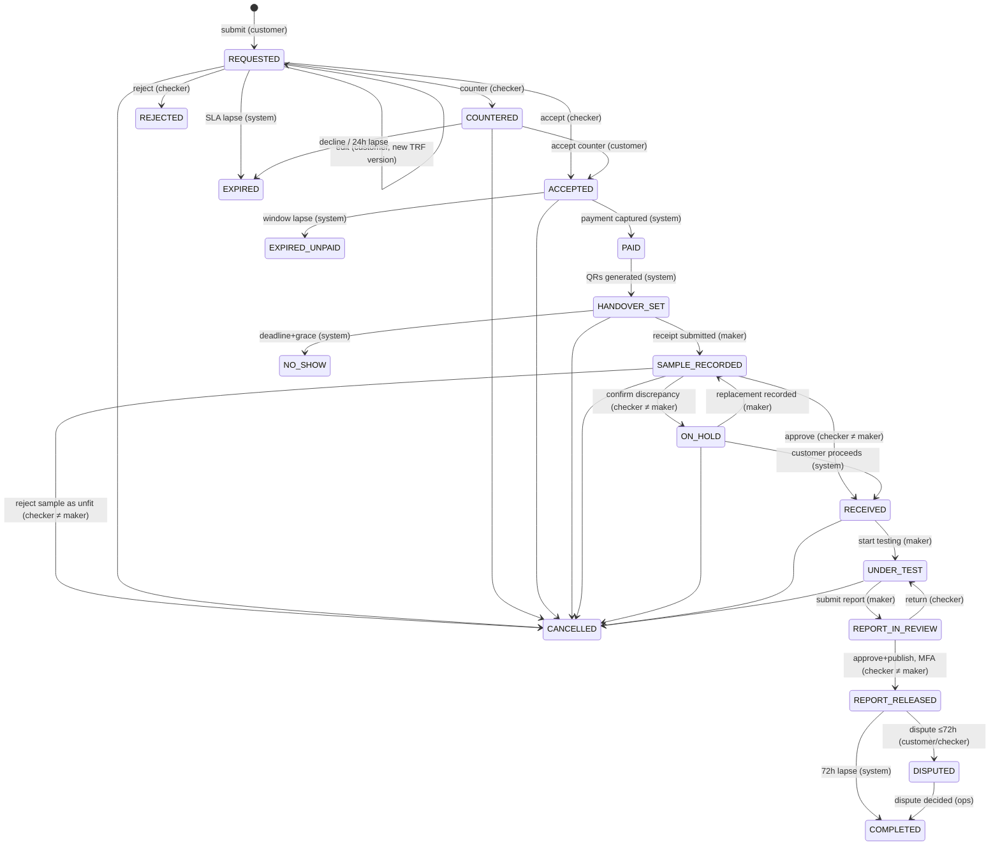

# Booking state machine

**Status:** Approved at gates G1 and G2 (2026-11-25). This document is authoritative. `packages/shared/src/booking-state-machine.ts` must match it exactly, and a test asserts that equality.

## 1. States

| State | Category | Meaning |
|---|---|---|
| `REQUESTED` | active | Submitted. Slot soft-held. Waiting for the lab Checker. |
| `COUNTERED` | active | The Checker proposed a different slot and/or extra quantity. Waiting for the customer. |
| `ACCEPTED` | active | Lab accepted at the snapshot price. Payment window open. |
| `PAID` | transient | Payment captured. The system immediately moves the booking to HANDOVER_SET. |
| `HANDOVER_SET` | active | Instructions and QRs issued. Waiting for the self-drop. |
| `SAMPLE_RECORDED` | active | The Maker submitted a receipt record. Waiting for the Checker. |
| `ON_HOLD` | active | The Checker confirmed a discrepancy. Waiting for the customer's decision. |
| `RECEIVED` | active | Receipt approved. Lab sample ID set. |
| `UNDER_TEST` | active | Testing in progress. |
| `REPORT_IN_REVIEW` | active | The Maker submitted a report version. Waiting for the Checker. |
| `REPORT_RELEASED` | active | Report published. The 72 h dispute window is running. |
| `DISPUTED` | active | Dispute open. Payout on hold. |
| `COMPLETED` | terminal | Window ended or dispute resolved. Payout or refund executed or scheduled. |
| `REJECTED` | terminal | The Checker rejected the request. |
| `EXPIRED` | terminal | The lab didn't decide in time, or the customer didn't answer a counter. |
| `EXPIRED_UNPAID` | terminal | Payment window lapsed. |
| `NO_SHOW` | terminal | No drop by the deadline plus grace. |
| `CANCELLED` | terminal | Cancelled by the customer, lab or Ops, with a `cancellation_code`. |

There's no `IN_TRANSIT` state and no logistics state (FS amendment A.4). `PAYMENT_PENDING` is a payment-order status, not a booking state (R-16).

## 2. Diagram

## 3. Transition table

`T-xx` IDs are used in code (`TransitionId`), tests and audit records.

| ID | From | To | Command | Actor | Guards | Side effects |
|---|---|---|---|---|---|---|
| T-01 | — | REQUESTED | `SubmitBooking` | C-Admin, C-Req, (Ops on behalf) | Site bookable (BR-001). Lines in scope and priced (BR-003). Slot capacity. Open-booking limit (BR-015). | Snapshot lines and TRF v1. Slot hold. Timer `LAB_DECISION_DUE`. Event `booking.requested`. |
| T-02 | REQUESTED | REQUESTED | `EditBooking` | owner, C-Admin | `If-Match` version | TRF v+1, re-snapshot, SLA timer restarts |
| T-03 | REQUESTED | ACCEPTED | `AcceptBooking` | L-Checker of the site | Site still bookable | Price final. Hold converts to booking. Timer `PAYMENT_DUE` (24 h). |
| T-04 | REQUESTED | COUNTERED | `CounterBooking` | L-Checker | Only `slot_id` and/or `extra_quantity` fields (BR-017) | `counter_offer` row. Timer `COUNTER_RESPONSE_DUE`. |
| T-05 | REQUESTED | REJECTED | `RejectBooking` | L-Checker | `reason_code` required | Hold released. Alternatives event. |
| T-06 | REQUESTED | EXPIRED | `ExpireDecision` | system | Timer fired, status unchanged | Hold released. Responsiveness metric. |
| T-07 | COUNTERED | ACCEPTED | `AcceptCounter` | owner, C-Admin | Counter is PENDING. New slot still has capacity. | Slot swap. Timer `PAYMENT_DUE`. |
| T-08 | COUNTERED | EXPIRED | `DeclineCounter` / `ExpireCounter` | owner / system | — | Hold released |
| T-09 | ACCEPTED | PAID | `ConfirmPayment` | system (Payments) | Verified capture equals the booking total | Ledger journal. Receipt document. Event. |
| T-10 | ACCEPTED | EXPIRED_UNPAID | `ExpirePayment` | system | No pending payment order (otherwise extend, BR-032) | Slot released |
| T-11 | PAID | HANDOVER_SET | `IssueHandover` | system | — | Booking QR and package QRs. Drop deadline. Timers `DROP_DEADLINE`, `NO_SHOW_DUE`. |
| T-12 | HANDOVER_SET | NO_SHOW | `MarkNoShow` | system | No receipt record | Refund minus fee (BR-072). Slot hold released. |
| T-13 | HANDOVER_SET | SAMPLE_RECORDED | `SubmitReceipt` | L-Maker of the site | ≥1 package scanned at this site | `receipt_record` (maker). Timer `RECEIPT_APPROVAL_REMINDER`. The item waits for a Checker; it is never decided automatically (EC-54). |
| T-14 | SAMPLE_RECORDED | RECEIVED | `ApproveReceipt` | L-Checker | checker ≠ maker. Lab sample ID present. | Packages → RECEIVED. `retain_until`. Event. |
| T-15 | SAMPLE_RECORDED | ON_HOLD | `ConfirmDiscrepancy` | L-Checker | checker ≠ maker. Reason required. | `hold_case`. Timer `HOLD_DECISION_DUE` (24 h). |
| T-16 | ON_HOLD | RECEIVED | `CustomerProceed` | owner, C-Admin | Hold case open. Receipt record is HOLD_CONFIRMED with a lab sample ID. | Deviation flag on booking. Packages → RECEIVED. `retain_until` counted from the customer's decision (BR-049). Event. |
| T-17 | ON_HOLD | SAMPLE_RECORDED | `SubmitReplacementReceipt` | L-Maker | Customer chose REPLACE. New or top-up packages scanned. | New receipt record version |
| T-18 | RECEIVED | UNDER_TEST | `StartTesting` | L-Maker | — | `expected_report_date` required. Timer `REPORT_DUE`. |
| T-19 | UNDER_TEST | REPORT_IN_REVIEW | `SubmitReport` | L-Maker | File CLEAN. Bound package belongs to the booking (BR-063). Parameters ⊆ lines (BR-061). ULR unique. | Verification code and signing key assigned. **Stamp job** (ADR-014). Timer `REPORT_APPROVAL_REMINDER`. |
| T-20 | REPORT_IN_REVIEW | UNDER_TEST | `ReturnReport` | L-Checker | Comments required | Version → RETURNED |
| T-21 | REPORT_IN_REVIEW | REPORT_RELEASED | `PublishReport` | L-Checker | checker ≠ maker. Step-up MFA ≤ 5 min. The stamp job has finished (`stamped_file_id` set). | Version RELEASED, in one synchronous transaction. The previous RELEASED version, if any, becomes SUPERSEDED. Timer `DISPUTE_WINDOW_END` (72 h). |
| T-22 | REPORT_RELEASED | DISPUTED | `RaiseDispute` | C-Admin, C-Req (own), C-Fin, L-Checker | Within the window (or billing type) | `dispute`. Automatic `payout_hold`. |
| T-23 | REPORT_RELEASED | COMPLETED | `CompleteBooking` | system | Timer fired. No open dispute. | Payout eligible (unless a hold exists) |
| T-24 | DISPUTED | COMPLETED | `ResolveDispute` | P-Ops, system | Dispute decided, or withdrawn by the party that raised it | Refund and/or payout per decision. On withdrawal: payout hold released, no refund. |
| T-25 | REQUESTED, COUNTERED, ACCEPTED | CANCELLED | `CancelBooking` | owner, C-Admin, Ops, system (EC-01) | — | Free (BR-070). Hold released. |
| T-26 | HANDOVER_SET | CANCELLED | `CancelBooking` | owner, C-Admin, L-Checker, Ops, system (EC-01) | — | Refund minus fee (customer) or 100% (lab, system). Slot hold released. |
| T-27 | SAMPLE_RECORDED, ON_HOLD, RECEIVED, UNDER_TEST | CANCELLED | `CancelBooking` | owner, C-Admin, L-Checker, Ops, system (EC-01) | Line statuses supplied | Per-line refund (BR-073 to BR-075). Slot hold released. A hold decision of `CANCEL` uses this transition from ON_HOLD. |
| T-28 | SAMPLE_RECORDED | CANCELLED | `RejectSample` | L-Checker | checker ≠ maker. Reason required. | Receipt record → REJECTED_UNFIT. Custody event `SAMPLE_REJECTED`. Refund minus handling fee (BR-076, EC-35). Slot hold released. |

**Rules**
- Any transition not in this table returns `409 INVALID_STATE_TRANSITION` with `currentState`. The table `booking_transition` holds the same rows, and the database trigger `trg_booking_status_guard` refuses any status change that is not one of them.
- While `booking.frozen_at` is set (EC-01), only T-25 to T-27 and Ops actions are accepted.
- **Not decided yet:** Ops overriding a lab decision (T-03 to T-05) and Ops cancelling from REPORT_IN_REVIEW, REPORT_RELEASED or DISPUTED (OQ-24); billing disputes outside REPORT_RELEASED (OQ-25); bookings without a slot (OQ-26); a payment captured after EXPIRED_UNPAID (OQ-27). Until then none of these is a transition.
- Every transition writes `booking_status_history` (with `transition_id`), `audit_log` and `outbox_event` in the same transaction.
- Timers check the current state when they fire and do nothing if it has moved on (idempotent).
- Report amendments after REPORT_RELEASED or COMPLETED **don't change the booking state**. They live in the report version lifecycle (`05-integrations/FILES_AND_REPORTS.md`). Whether an amendment reopens the dispute window is OQ-14. The default is that it doesn't.

## 4. Sub-state machines

**Payment order:** `CREATED → PENDING → CAPTURED | FAILED | EXPIRED`, plus `CAPTURED → REFUNDED_PARTIAL | REFUNDED_FULL`.
**Package:** `ISSUED → RECEIVED | MISSING | VOIDED`. A reprint makes `VOIDED` plus a new `ISSUED` label version.
**Receipt record:** `SUBMITTED → APPROVED | HOLD_CONFIRMED | REJECTED_UNFIT`.
**Report version:** `DRAFT → IN_REVIEW → RETURNED | RELEASED`, `RELEASED → SUPERSEDED`.
**Dispute:** `OPEN → AWAITING_LAB → UNDER_REVIEW → DECIDED → CLOSED` (or `WITHDRAWN`).
**Payout:** `PENDING → ON_HOLD ↔ ELIGIBLE → RELEASED | FAILED`, or `CANCELLED`.
**Booking line:** `NOT_STARTED → IN_PROGRESS → DONE`, or `CANCELLED` (from `NOT_STARTED` or `IN_PROGRESS`, by agreement).

## 5. As built (P3-07)

`packages/core/src/booking/` holds the BookingEngine skeleton: the one mechanism every transition goes through, with the per-feature guards and effects left to plug in. It is Nest-free (ADR-020); the transition data comes from `packages/shared` and is not copied.

- **API.** `BookingEngine.transition(tx, command)` for T-02 to T-28 and `BookingEngine.submit(tx, command)` for T-01 (it inserts the booking, because T-01 has no from-state; OQ-99). `transitionIfStatus` is `transition` for timer jobs: if the booking is gone or no longer in the expected state it writes nothing and answers `{ applied: false }`. All three run in the caller's transaction, opened with `withDbContext`.
- **Steps of `transition`.** (1) read the caller's database context; (2) `SELECT ... FOR UPDATE` the booking, then load it (RLS decides what is visible; an invisible booking is `NOT_FOUND`); (3) the current state must be a `from` state, else `INVALID_STATE_TRANSITION` with `meta.currentState`; (4) a frozen booking accepts only T-25 to T-27 and Ops (OQ-97); (5) the actor must be listed for the transition (`FORBIDDEN`): the command's user, organisation and SYSTEM claim are checked against the database context, so a request cannot call itself SYSTEM or Ops, and a customer or lab role must belong to the booking's customer or lab organisation (never taken from the command); (6) `expectedLockVersion` (`CONCURRENT_MODIFICATION`); (7) the registered guards; (8) the booking columns the new state fixes (below) and registered column contributors; (9) `set_config('app.transition_id', ..., true)`, one `UPDATE` of `status` and `lock_version`, and the setting is cleared again, so a later raw status update in the same transaction is refused by `trg_booking_status_guard`; (10) the `booking_status_history` row; (11) the registered effects; (12) the `booking.transition` audit entry; (13) the outbox events. Any throw rolls all of it back.
- **Columns written with the status** (CHECK constraints are evaluated at that UPDATE): `payment_due_at` (to ACCEPTED, `payment.window_minutes`), `rejection_reason_node_id` (T-05), `cancellation_code_node_id` and `cancelled_by_party` (T-25 to T-28), `deviation_noted` (T-16), `expected_report_date` (T-18), `report_released_at` and `dispute_window_ends_at` (T-21, `dispute.window_minutes`), `completed_at` (to COMPLETED). Required inputs are listed in OQ-101.
- **Events.** One or two outbox events per transition, with the codes of `NOTIFICATIONS_MATRIX.md` (`packages/core/src/booking/events.ts`, OQ-95). T-02, T-09, T-23 and T-24 raise none. The payload is the booking id, both states and the transition id; the actor is in the envelope.
- **Registry.** `TransitionRegistry` holds guards, effects and column contributors per transition (or `'ALL'`), in registration order, with a unique name per kind. An empty registry is a working engine. `registerDefaultBookingEffects` adds the timer effects the document fully specifies (OQ-96): cancel the booking's timers that the new state makes obsolete (`TIMER_LIVE_STATES`), `PAYMENT_DUE` and `PAYMENT_REMINDER` at T-03 and T-07, `COUNTER_RESPONSE_DUE` at T-04, `HOLD_DECISION_DUE` at T-15, `DISPUTE_WINDOW_END` at T-21. The lab's business hours belong to the labs module, so the engine only defines the `WorkingHoursProvider` port.
- **Timers.** `createBookingTimerHandlers` returns handlers that re-check the state and do nothing if it moved on: `LAB_DECISION_DUE` applies T-06, `COUNTER_RESPONSE_DUE` T-08, `NO_SHOW_DUE` T-12, `DISPUTE_WINDOW_END` T-23 and, only when the app passes a `hasPendingPayment` check (BR-032, OQ-100), `PAYMENT_DUE` T-10. Reminder timers emit only their documented event (OQ-104). The worker registers them once in `onModuleInit` of `BookingWorkerModule` (`apps/worker/src/modules/booking/`), which also builds the worker's single `BookingEngine` (default effects and the T-09 guard) that payments uses too, so the `timers` job now fires them for real, including `PAYMENT_DUE` with `createHasPendingPayment` (BR-032). A timer that fires on a frozen booking fails and is retried (OQ-97, OQ-163); the job logs counts only. `packages/core/test/db/booking-worker-flow.test.ts` drives the flow end to end. The API builds the same engine (`createBookingEngine`, ADR-023) in its `BookingModule`, which payments uses too, and runs no timers (OQ-162).
- **Errors.** The engine throws `BookingError` (`packages/core/src/booking/errors.ts`): a `code` of the catalogue in `packages/shared`, `status`, `detail`, `meta`. The API filter must map it like a `DomainError` (`isBookingError(e)` then `new DomainError(e.code, { detail: e.detail, meta: e.meta })`).
- **One writer.** `booking.status` is written only in `engine.ts`. `src/booking/single-writer.test.ts` scans `apps/` and `packages/core/src` for any other writer; its limits are in the test. The database trigger remains the backstop.
- **Not in the engine** (feature increments register them in `createBookingTransitionRegistry`, ADR-023): the business guards of §3 and their effects. Registered so far (I3-LAB-01, `registerLabDecisionRules`): the T-03 bookable-site guard and the slot hold (confirmed on T-03; released on T-05, T-06, T-08, T-10, T-12 and T-25 to T-28), the T-04 counter checks and the `counter_offer` row; `registerCounterResponseRules`: the T-07 guards (counter PENDING and unexpired, proposed slot with room), the slot swap (both slots locked in id order), the agreed quantities on the lines, and the offer answered on T-07 (ACCEPTED) and T-08 (DECLINED by the owner, EXPIRED by the timer), and a T-25 cancellation of a COUNTERED booking closes the offer as EXPIRED. T-01 and T-02 (I3-CUS-01, `booking/submission.ts`) write what the engine does not own in the same transaction: the priced lines and their snapshots, the TRF version, the lab snapshot, the soft hold and the lab decision timers (OQ-96). Still to come: receipt and report rules, MFA, the stamp job, ledger, packages, report versions, and "checker ≠ maker" (`differentFromMakerGuard`, OQ-103).
