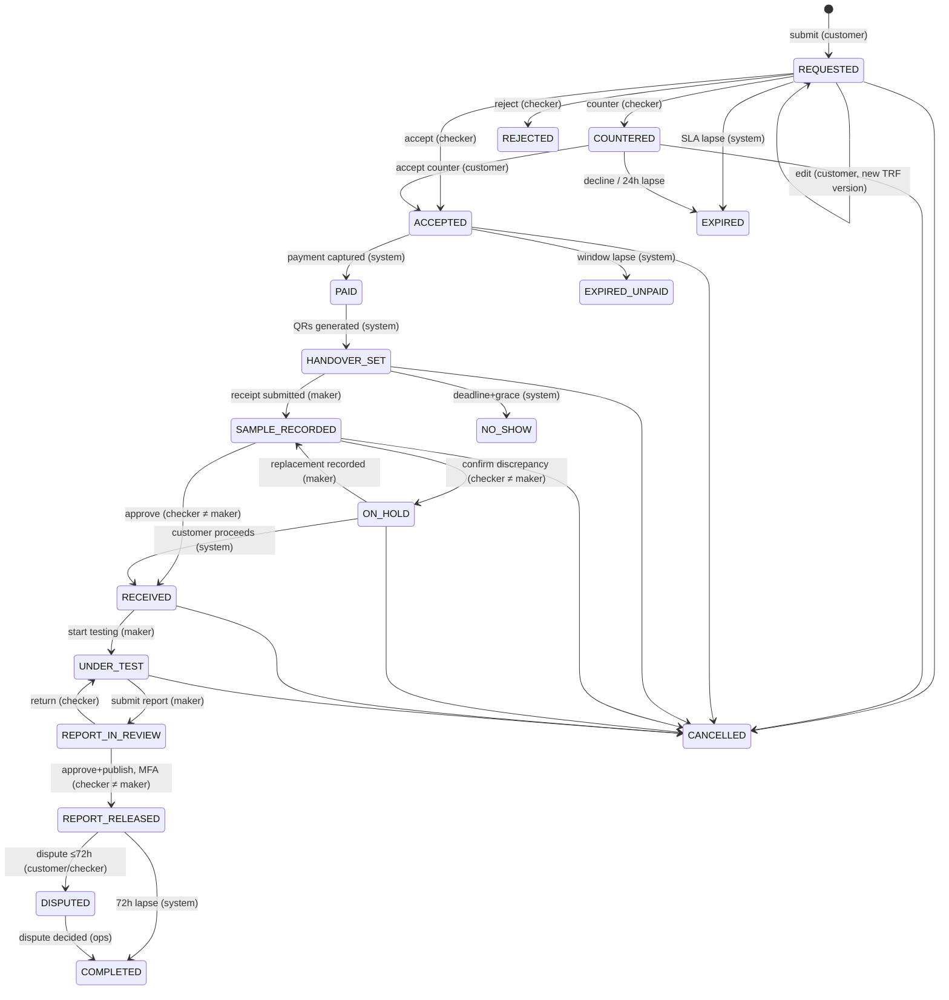

# Booking state machine

**Status:** DRAFT for gate G1/G2. This document is authoritative. `packages/shared/src/booking-state-machine.ts` must match it exactly, and a test asserts that equality.

## 1. States

| State | Category | Meaning |
|---|---|---|
| `REQUESTED` | active | Submitted. Slot soft-held. Waiting for the lab Checker. |
| `COUNTERED` | active | The Checker proposed a different slot and/or extra quantity. Waiting for the customer. |
| `ACCEPTED` | active | Lab accepted at the snapshot price. Payment window open. |
| `PAID` | transient | Payment captured. The system immediately moves the booking to HANDOVER_SET. |
| `HANDOVER_SET` | active | Instructions and QRs issued. Waiting for the self-drop. |
| `SAMPLE_RECORDED` | active | The Maker submitted a receipt record. Waiting for the Checker. |
| `ON_HOLD` | active | The Checker confirmed a discrepancy. Waiting for the customer's decision. |
| `RECEIVED` | active | Receipt approved. Lab sample ID set. |
| `UNDER_TEST` | active | Testing in progress. |
| `REPORT_IN_REVIEW` | active | The Maker submitted a report version. Waiting for the Checker. |
| `REPORT_RELEASED` | active | Report published. The 72 h dispute window is running. |
| `DISPUTED` | active | Dispute open. Payout on hold. |
| `COMPLETED` | terminal | Window ended or dispute resolved. Payout or refund executed or scheduled. |
| `REJECTED` | terminal | The Checker rejected the request. |
| `EXPIRED` | terminal | The lab didn't decide in time, or the customer didn't answer a counter. |
| `EXPIRED_UNPAID` | terminal | Payment window lapsed. |
| `NO_SHOW` | terminal | No drop by the deadline plus grace. |
| `CANCELLED` | terminal | Cancelled by the customer, lab or Ops, with a `cancellation_code`. |

There's no `IN_TRANSIT` state and no logistics state (FS amendment A.4). `PAYMENT_PENDING` is a payment-order status, not a booking state (R-16).

## 2. Diagram

## 3. Transition table

`T-xx` IDs are used in code (`TransitionId`), tests and audit records.

| ID | From | To | Command | Actor | Guards | Side effects |
|---|---|---|---|---|---|---|
| T-01 | — | REQUESTED | `SubmitBooking` | C-Admin, C-Req, (Ops on behalf) | Site bookable (BR-001). Lines in scope and priced (BR-003). Slot capacity. Open-booking limit (BR-015). | Snapshot lines and TRF v1. Slot hold. Timer `LAB_DECISION_DUE`. Event `booking.requested`. |
| T-02 | REQUESTED | REQUESTED | `EditBooking` | owner, C-Admin | `If-Match` version | TRF v+1, re-snapshot, SLA timer restarts |
| T-03 | REQUESTED | ACCEPTED | `AcceptBooking` | L-Checker of the site | Site still bookable | Price final. Hold converts to booking. Timer `PAYMENT_DUE` (24 h). |
| T-04 | REQUESTED | COUNTERED | `CounterBooking` | L-Checker | Only `slot_id` and/or `extra_quantity` fields (BR-017) | `counter_offer` row. Timer `COUNTER_RESPONSE_DUE`. |
| T-05 | REQUESTED | REJECTED | `RejectBooking` | L-Checker | `reason_code` required | Hold released. Alternatives event. |
| T-06 | REQUESTED | EXPIRED | `ExpireDecision` | system | Timer fired, status unchanged | Hold released. Responsiveness metric. |
| T-07 | COUNTERED | ACCEPTED | `AcceptCounter` | owner, C-Admin | Counter is PENDING. New slot still has capacity. | Slot swap. Timer `PAYMENT_DUE`. |
| T-08 | COUNTERED | EXPIRED | `DeclineCounter` / `ExpireCounter` | owner / system | — | Hold released |
| T-09 | ACCEPTED | PAID | `ConfirmPayment` | system (Payments) | Verified capture equals the booking total | Ledger journal. Receipt document. Event. |
| T-10 | ACCEPTED | EXPIRED_UNPAID | `ExpirePayment` | system | No pending payment order (otherwise extend, BR-032) | Slot released |
| T-11 | PAID | HANDOVER_SET | `IssueHandover` | system | — | Booking QR and package QRs. Drop deadline. Timers `DROP_DEADLINE`, `NO_SHOW_DUE`. |
| T-12 | HANDOVER_SET | NO_SHOW | `MarkNoShow` | system | No receipt record | Refund minus fee (BR-072) |
| T-13 | HANDOVER_SET | SAMPLE_RECORDED | `SubmitReceipt` | L-Maker of the site | ≥1 package scanned at this site | `receipt_record` (maker). Timer `RECEIPT_APPROVAL_DUE`. |
| T-14 | SAMPLE_RECORDED | RECEIVED | `ApproveReceipt` | L-Checker | checker ≠ maker. Lab sample ID present. | Packages → RECEIVED. `retain_until`. Event. |
| T-15 | SAMPLE_RECORDED | ON_HOLD | `ConfirmDiscrepancy` | L-Checker | checker ≠ maker. Reason required. | `hold_case`. Timer `HOLD_DECISION_DUE` (24 h). |
| T-16 | ON_HOLD | RECEIVED | `CustomerProceed` | owner, C-Admin | Hold case open | Deviation flag on booking. Lab sample ID from the hold decision. |
| T-17 | ON_HOLD | SAMPLE_RECORDED | `SubmitReplacementReceipt` | L-Maker | Customer chose REPLACE. New or top-up packages scanned. | New receipt record version |
| T-18 | RECEIVED | UNDER_TEST | `StartTesting` | L-Maker | — | `expected_report_date` required. Timer `REPORT_DUE`. |
| T-19 | UNDER_TEST | REPORT_IN_REVIEW | `SubmitReport` | L-Maker | File CLEAN. Bound package belongs to the booking (BR-063). Parameters ⊆ lines (BR-061). ULR unique. | Timer `REPORT_APPROVAL_DUE` |
| T-20 | REPORT_IN_REVIEW | UNDER_TEST | `ReturnReport` | L-Checker | Comments required | Version → RETURNED |
| T-21 | REPORT_IN_REVIEW | REPORT_RELEASED | `PublishReport` | L-Checker | checker ≠ maker. Step-up MFA ≤ 5 min. | Stamp job. Version RELEASED. Timer `DISPUTE_WINDOW_END` (72 h). |
| T-22 | REPORT_RELEASED | DISPUTED | `RaiseDispute` | C-Admin, C-Req (own), C-Fin, L-Checker | Within the window (or billing type) | `dispute`. Automatic `payout_hold`. |
| T-23 | REPORT_RELEASED | COMPLETED | `CompleteBooking` | system | Timer fired. No open dispute. | Payout eligible (unless a hold exists) |
| T-24 | DISPUTED | COMPLETED | `ResolveDispute` | P-Ops | Dispute decided | Refund and/or payout per decision |
| T-25 | REQUESTED, COUNTERED, ACCEPTED | CANCELLED | `CancelBooking` | owner, C-Admin, Ops | — | Free (BR-070). Hold released. |
| T-26 | HANDOVER_SET | CANCELLED | `CancelBooking` | owner, C-Admin, L-Checker, Ops | — | Refund minus fee (customer) or 100% (lab) |
| T-27 | SAMPLE_RECORDED, ON_HOLD, RECEIVED, UNDER_TEST | CANCELLED | `CancelBooking` | owner, C-Admin, L-Checker, Ops | Line statuses supplied | Per-line refund (BR-073 to BR-076) |

**Rules**
- Any transition not in this table returns `409 INVALID_STATE_TRANSITION` with `currentState`.
- Every transition writes `booking_status_history` (with `transition_id`), `audit_log` and `outbox_event` in the same transaction.
- Timers check the current state when they fire and do nothing if it has moved on (idempotent).
- Report amendments after REPORT_RELEASED or COMPLETED **don't change the booking state**. They live in the report version lifecycle (`05-integrations/FILES_AND_REPORTS.md`). Whether an amendment reopens the dispute window is OQ-14. The default is that it doesn't.

## 4. Sub-state machines

**Payment order:** `CREATED → PENDING → CAPTURED | FAILED | EXPIRED`, plus `CAPTURED → REFUNDED_PARTIAL | REFUNDED_FULL`.
**Package:** `ISSUED → RECEIVED | MISSING | VOIDED`. A reprint makes `VOIDED` plus a new `ISSUED` label version.
**Receipt record:** `SUBMITTED → APPROVED | HOLD_CONFIRMED | REJECTED_UNFIT`.
**Report version:** `DRAFT → IN_REVIEW → RETURNED | RELEASED`, `RELEASED → SUPERSEDED`.
**Dispute:** `OPEN → AWAITING_LAB → UNDER_REVIEW → DECIDED → CLOSED` (or `WITHDRAWN`).
**Payout:** `PENDING → ON_HOLD ↔ ELIGIBLE → RELEASED | FAILED`, or `CANCELLED`.
**Booking line:** `NOT_STARTED → IN_PROGRESS → DONE`, or `CANCELLED` (from `NOT_STARTED` or `IN_PROGRESS`, by agreement).
