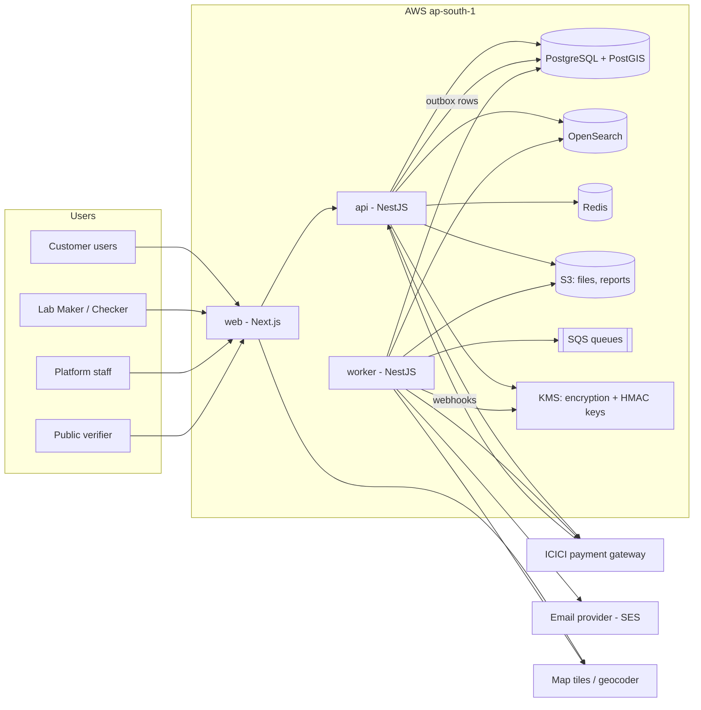

# System architecture

**Status:** DRAFT for gate G1/G2.

## 1. Style
A **modular monolith**, deployed as two runtime services that share one codebase and one database:
- `api`: NestJS HTTP API (synchronous requests, webhooks).
- `worker`: NestJS standalone application that runs the outbox relay, SQS consumers, the timer processor, scheduled jobs (reconciliation, search sync, expiry sweeps) and file post-processing.

Plus `web`, the Next.js application (SSR for public lab pages and verification, and client dashboards for customer, lab and admin).

Services are split out only if load or team size demands it (ADR-001).

## 2. Context diagram

## 3. Components

| Component | Responsibility | Tech |
|---|---|---|
| web | Public search, lab pages, verification page (SSR), dashboards, browser QR scanner with offline queue | Next.js App Router, React, TypeScript, Tailwind, shadcn/ui, TanStack Query |
| api | REST `/v1`, auth, RBAC, domain modules, webhook intake | NestJS, Prisma, Zod/class-validator |
| worker | Outbox relay → SQS, consumers (notifications, search indexing, files), timers, reconciliation, sweeps | NestJS standalone, AWS SDK |
| PostgreSQL 16 + PostGIS | Source of truth, including geo queries | Amazon RDS (Multi-AZ in prod) |
| OpenSearch | Derived search index (scope lines with geo_point) | Amazon OpenSearch Service |
| Redis | Rate limits, OTP throttles, short-lived caches. **Not** used for business locks that must survive a restart (those use Postgres). | ElastiCache for Redis / Valkey |
| S3 | Report originals and stamped copies, photos, attachments, KYC docs, imports, financial PDFs | Versioning, SSE-KMS, Block Public Access |
| SQS | Event distribution, with a DLQ per queue | Standard queues. FIFO where per-booking order matters (`notifications`). |
| KMS | Data keys for S3 and RDS. HMAC keys for QR signing (`GenerateMac`/`VerifyMac`). | — |
| SES | Transactional email (ap-south-1) | Behind the `EmailChannel` interface |
| Malware scanning | Scan every upload before it's usable | GuardDuty Malware Protection for S3 (availability to verify, ADR-010) |

## 4. Key flows

### 4.1 Write path for any state change
1. The API guard authenticates, resolves the membership and checks permission.
2. The domain service opens a transaction, loads the aggregate with `SELECT … FOR UPDATE`, and validates the state transition and rules.
3. It writes the changes, a `booking_status_history` row, an `audit_log` row and an `outbox_event` row **in the same transaction**.
4. Commit. The worker relays outbox rows to SQS. Consumers send notifications, update search, schedule timers, and so on.

### 4.2 Payment
Customer: Pay → API creates a `payment_order` (idempotency key) → `PaymentGateway.createOrder()` → hosted checkout (no card data touches LabConnect) → the gateway webhook hits `/v1/webhooks/payments/icici` → signature verified, `gateway_webhook_event` stored (unique event id) → the Payments module marks it captured → the Booking engine moves `ACCEPTED → PAID → HANDOVER_SET` → ledger journal → events. Reconciliation polls `fetchStatus()` for pending orders.

### 4.3 Self-drop receipt
On HANDOVER_SET, Custody generates the booking QR and package QRs (KMS HMAC) → the customer prints labels → at the lab, the Maker's browser scanner reads the QR → `POST /v1/custody/scan` verifies the signature, key status, site match and package state, and writes a custody event → the Maker submits the receipt record → the Checker decides → RECEIVED or ON_HOLD.

### 4.4 Report release
The Maker requests an upload URL → uploads the PDF straight to the S3 quarantine prefix → a malware scan result event arrives → the worker validates the PDF, computes SHA-256 and promotes the file to the clean prefix → the Maker binds and submits → the worker stamps the verification QR onto a copy (the original is kept) and hashes it → the Checker reviews the stamped copy and publishes with step-up MFA → in one transaction: version RELEASED, booking REPORT_RELEASED, 72 h timer → payout eligibility (ADR-014).

## 5. Cross-cutting
- **Time:** UTC in storage. Business calculations use the `Asia/Kolkata` business calendar. An injectable `Clock` keeps timers testable.
- **Idempotency:** `Idempotency-Key` on every POST that has side effects. Stored in Postgres for financial and state operations.
- **Concurrency:** optimistic `lock_version` on aggregates for API updates (`If-Match`), plus row locks inside transitions.
- **Adapters:** `PaymentGateway`, `EmailChannel`, `SmsChannel` (stub), `WhatsAppChannel` (stub), `Geocoder`, `MapTiles`, `MalwareScanner`, `SearchIndex`, `QrSigner`, `PdfStamper`. Each has a fake implementation for tests and local work.
- **Feature flags:** `config_parameter` entries with code-level defaults (no third-party service).

## 6. Environments
Local (docker-compose + LocalStack), UAT (from `main`), Production (from `production`). See `07-operations/AWS_ENVIRONMENTS_AND_DEPLOYMENT.md`.
