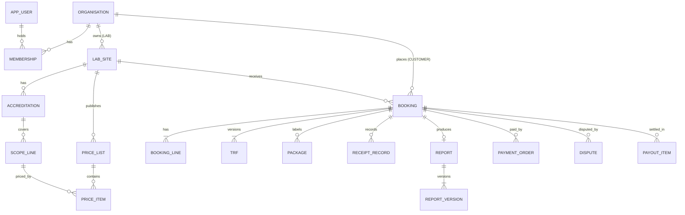
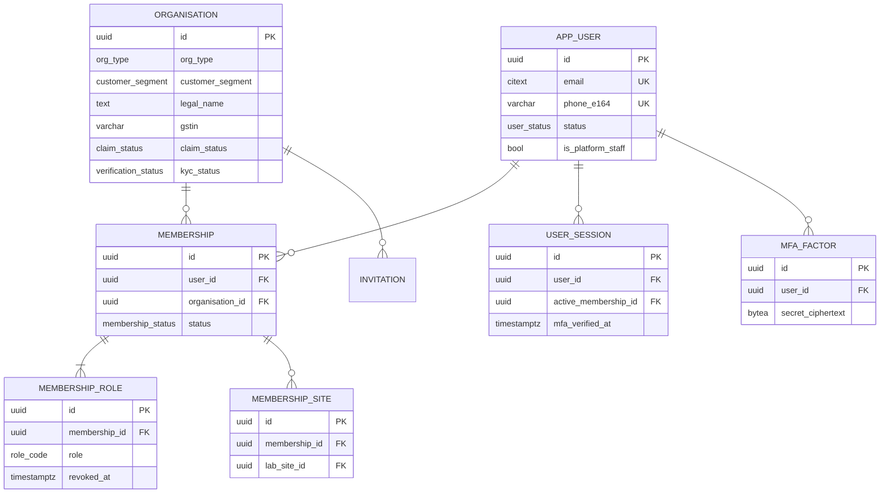
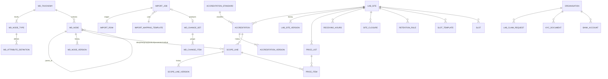
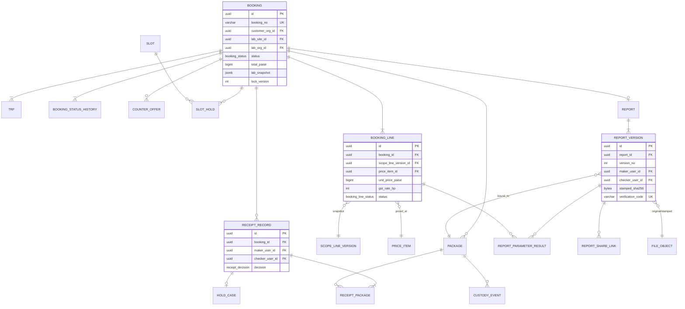
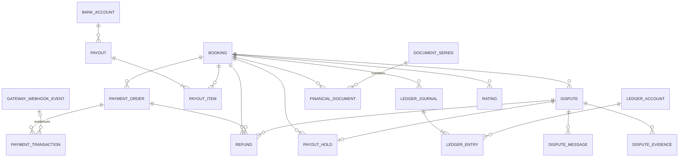
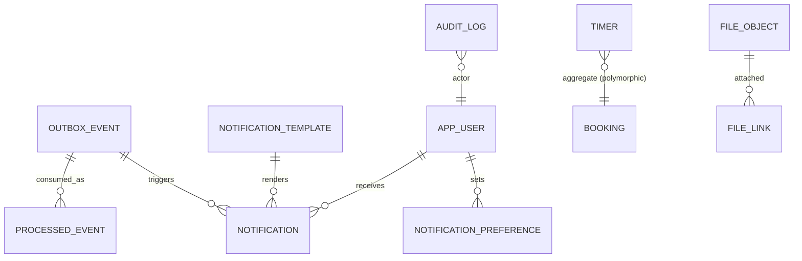

# Entity relationship diagrams

**Status:** DRAFT for gate G1. The diagrams are split by area so they stay readable. Only key columns are shown. The full definitions are in `SCHEMA_SPECIFICATION.md`. GitHub renders Mermaid natively.

## 1. Overview

## 2. Identity

## 3. Master data and labs

## 4. Booking, custody and reports

## 5. Payments, ledger and disputes

## 6. Platform

## 7. Tables added by the P1-01 review, and tables not drawn above

```mermaid
erDiagram
  AUDIT_LOG ||--o| AUDIT_LOG_CHAIN : sealed_by
  ORGANISATION ||--|| ORGANISATION_PRIVATE : ""
  ORGANISATION ||--o{ ORGANISATION_VERSION : history
  INVITATION ||--o{ INVITATION_SITE : ""
  LAB_SITE ||--o{ INVITATION_SITE : ""
  LAB_SITE ||--|| LAB_SITE_PRIVATE : ""
  ORGANISATION ||--o{ LAB_PENALTY : ""
  SEARCH_SYNONYM ||--o{ SEARCH_SYNONYM_VERSION : history
  BOOKING_TRANSITION }o--|| BOOKING : "guards status of"
  CUSTODY_EVENT ||--o{ CUSTODY_EVENT_PHOTO : ""
  FILE_OBJECT ||--o{ CUSTODY_EVENT_PHOTO : ""
  REPORT_VERSION ||--o{ BREAK_GLASS_GRANT : ""
  BREAK_GLASS_GRANT ||--o{ REPORT_ACCESS_LOG : ""
  REPORT_VERSION ||--o{ REPORT_ACCESS_LOG : ""
  BOOKING ||--o{ LABEL_PRINT : ""
  QR_SIGNING_KEY ||--o{ PACKAGE : signs
  ORGANISATION ||--o{ CUSTOMER_SITE : "owns (CUSTOMER)"
  ORGANISATION ||--o| CUSTOMER_SETTINGS : ""
  ACCREDITATION_BODY ||--o{ ACCREDITATION : issues
  APP_USER ||--o{ MFA_RECOVERY_CODE : ""
```

Standalone tables with no drawn relationship: `config_parameter`, `holiday_calendar`, `idempotency_record`, `otp_challenge`, `fee_rule`, `lead_request`, `settlement_report_line`, `verification_event`.
