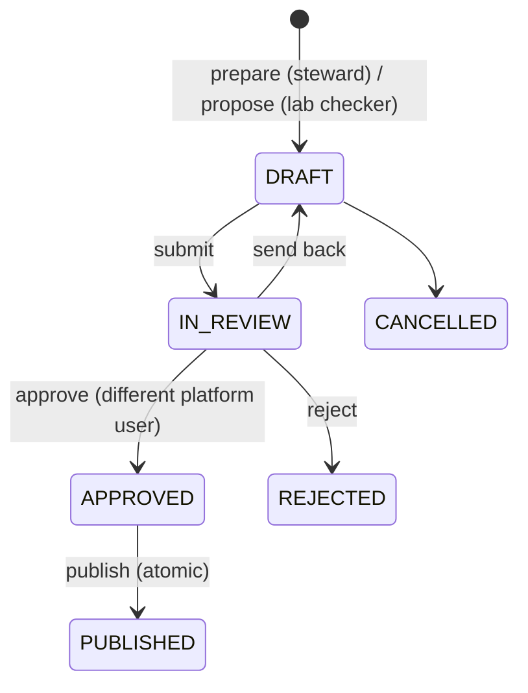

# Master data management

**Status:** Approved at gate G1 (2026-11-24). Covers FR-MDM-01..10 and FR-DAT-01..09.

## 1. Goals
- Accreditation frameworks, categories, scope hierarchies and attributes can change **without code changes** to transactional tables.
- Every change is reviewed, versioned, attributable and reversible (by a new change set).
- Imports from multiple sources and formats are previewed before anything is committed.
- There's a path to automated NABL ingestion that uses the same change-set pipeline.

## 2. Configurable model
```
md_taxonomy (SCOPE, METHOD, UNIT, SAMPLE_CONDITION, REJECTION_REASON, CANCELLATION_REASON,
             DISPUTE_TYPE, REFUND_REASON, KYC_DOCUMENT_TYPE, HOLD_REASON, ...)
  └─ md_node_type (levels, e.g. SCOPE: DISCIPLINE(1) → GROUP(2) → PRODUCT(3) → PARAMETER(4))
       └─ md_attribute_definition (typed extension attributes per level)
  └─ md_node (values; parent_id; code; aliases; attributes JSONB; ltree path)
```
- A new **level** (e.g. "Sub-group") is added by inserting an `md_node_type`. Transactional tables reference nodes by ID and don't care about depth. `scope_line` keeps explicit columns for the four levels used in search. A level added between them is reachable through `path` and doesn't need a schema change.
- A new **attribute** (e.g. "hazard class" on PRODUCT) is added as an `md_attribute_definition` and validated on write. `is_searchable` attributes are copied into the search index.
- A new **accreditation framework** (e.g. another standard) is an `accreditation_standard` row with `lab_category`, `is_supported` and `is_bookable` flags.
- **Controlled:** taxonomies marked `is_system` (SCOPE, METHOD, UNIT, and the reason-code taxonomies the code relies on) can't be deleted, and their codes are referenced by seed data.

## 3. Change-set lifecycle



**Publish** runs in one transaction. For each change item: check `base_version_no` (optimistic, so a stale change fails the whole set), apply it to the current row, append a `*_version` row, write audit and an outbox event (`masterdata.published` with affected IDs). Then the change set gets `published_at` and `impact_summary`.

**Impact analysis** (before approval): counts per operation, plus any **open bookings** affected by deactivated scope lines or accreditation status changes (EC-58). This is shown to the approver.

**Lab proposals** (`LAB_PROPOSAL`): a lab Checker proposes a map-pin correction (EC-04) or a scope correction. These follow the same review by platform staff.

## 4. Import pipeline

1. **Upload:** the file is stored as `IMPORT_SOURCE` and malware-scanned.
2. **Choose a mapping template** (versioned): column map, value transforms (trim, upper, date formats, split "IS 1786:2008" into code and year), and defaults.
3. **Parse** into `import_row.raw`, then **map** into `import_row.mapped`.
4. **Validate:** required fields, formats (certificate no., pincode, dates), and taxonomy resolution (code or alias, otherwise "unknown value" with suggested nearest matches using trigram).
5. **Match:**
   - Labs: by certificate number (primary), then name + pincode (secondary, warning only).
   - Accreditation: (`body`, `certificate_no`).
   - Scope lines: `natural_key_hash` within the site.
   - Duplicates within the file: same natural key, which shows `DUPLICATE_IN_FILE`.
   - Inconsistencies: valid_to < valid_from, scope under an expired accreditation, an ISO 15189 standard (rejected per CD-03), a calibration scope on a testing certificate.
6. **Geocode** new or changed addresses (worker, rate-limited). Low confidence is flagged `LOW_CONFIDENCE` for the Ops pin queue.
7. **Preview:** counts by action, a downloadable error report (CSV), and row-level drill-down. Unknown taxonomy values can be resolved inline by creating nodes in the **same change set**.
8. **Commit:** creates an `md_change_set` (source `IMPORT`) with change items, which then goes through review.

Lab **price-list imports** use the same parse, map and validate steps but target `price_list` (DRAFT) for the lab's own site. The Checker publishes, and there's no platform review (CD-06).

## 5. Sources and formats
- MVP: CSV and XLSX. NABL data exports supplied by the operating authority (permission to use: OQ-03).
- Mapping templates per source (`NABL export v1`, `Manual entry sheet v1`) are stored and versioned. A new source format needs a new template, not code.
- Later: an automated NABL fetcher writes the same `import_job` with source `NABL_SYNC` and produces a change set for review.

## 6. Admin UI requirements (for the design phase)
Taxonomy browser and editor, change-set inbox (mine / to review), import wizard (upload → map → preview → commit), diff viewer, version history per record, impact panel, and the geocode pin-review queue.

## 7. Search synchronisation
On `masterdata.published`, the worker re-indexes the affected sites and scope lines (see `05-integrations/SEARCH.md`). A full nightly rebuild acts as a backstop.
