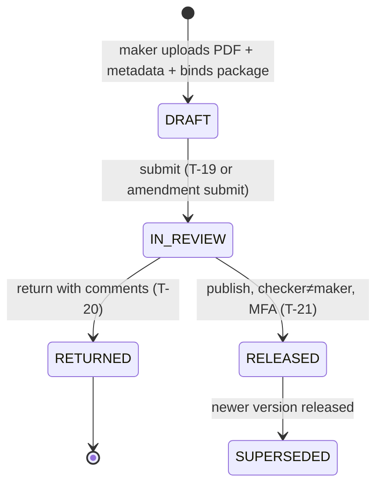

# Files and report management

**Status:** Approved at gates G1 and G2 (2026-11-25).

## 1. Upload pipeline (all file types)
1. The client requests an upload URL (`purpose`, declared type, size). The API checks the role, size limit and type allow-list, creates `file_object` (`PENDING`), and returns a **pre-signed S3 PUT** to `quarantine/<purpose>/<uuid>` (15 min, content-length and content-type conditions).
2. The client uploads straight to S3. Files never pass through the app servers.
3. **Malware scan** (GuardDuty Malware Protection for S3 on the quarantine prefix, ADR-010). The result event → `lc-files` queue.
4. The worker validates: magic-byte type matches the allow-list; for PDFs, it parses with a hardened library (rejects encrypted, corrupt, or JavaScript-bearing PDFs); for images, it strips EXIF and re-encodes; it computes SHA-256.
5. Clean → copy to `clean/<purpose>/<uuid>` (SSE-KMS) and set `scan_status=CLEAN` with `sha256`. Otherwise `INFECTED` or `REJECTED`, kept in quarantine with a 30-day lifecycle, and the user is notified.
6. Only `CLEAN` files can be referenced by domain commands (`FILE_NOT_CLEAN` otherwise).

| Purpose | Types | Max size |
|---|---|---|
| REPORT_ORIGINAL | PDF | 20 MB |
| RECEIPT_PHOTO | JPEG, PNG, HEIC→JPEG | 10 MB each, ≤ 10 per receipt |
| BOOKING_ATTACHMENT | PDF, JPEG, PNG, XLSX, DOCX | 25 MB in total |
| KYC_DOCUMENT | PDF, JPEG, PNG | 10 MB |
| DISPUTE_EVIDENCE | PDF, JPEG, PNG | 10 MB each |
| IMPORT_SOURCE | CSV, XLSX | 50 MB |

In the API contract (`components/schemas/files.yaml`) every upload request has one shape, `{fileName?, contentType, sizeBytes}`, narrowed per purpose to the types and size of this table, and every upload answer has one shape, `{fileId, uploadUrl, method: "PUT", headers, expiresAt}`. The client sends the PUT with exactly the returned `headers`, because the content type and length are conditions of the signature.

## 2. Downloads
- Only through `POST …/download-url`, which checks permission, writes `report_access_log` (for reports), and returns a **15-minute pre-signed GET** with `Content-Disposition: attachment`. The answer is always `{downloadUrl, expiresAt}`; a report download adds `copy` (`STAMPED` or `ORIGINAL`).
- Buckets: Block Public Access on. Bucket policy denies non-TLS. Versioning on. Object Lock (governance) for `REPORT_*` and `FINANCIAL_DOCUMENT` prefixes, for the retention period (to be confirmed with legal review).

## 3. Report lifecycle

A returned version stays RETURNED. The Maker creates a **new** DRAFT version (history is preserved, EC-52).

### Stamping and release (ADR-014)
Stamping happens at **submission**, not at publication. Publication is then a single synchronous transaction.
1. On submit (T-19, or an amendment submit), the worker generates `verification_code` (≥ 80 random bits, Crockford base32, 16 chars) and builds the report QR → `https://<public-host>/v/<verification_code>`.
2. It **stamps a copy**: the QR plus a small footer ("Verify at … · <code>") on page 1 (position configurable per lab, default bottom-right, with a fallback to an appended final page if there isn't enough space). **The original is never modified.** It computes `stamped_sha256` and stores the copy as `REPORT_STAMPED`.
3. The Checker reviews the **stamped** copy (what the customer will get). `publish` is blocked until the stamp job has finished (`stamped_file_id` set).
4. Publish (T-21) in one transaction: version → RELEASED, previous RELEASED → SUPERSEDED, booking → REPORT_RELEASED, timer, outbox.
5. Until release, `/v/<code>` returns **Not found**, so a code leaked during review proves nothing.
6. If stamping fails, the job retries and Ops is alerted. The Maker can still see the version as "Preparing for review".

### Amendment (FR-RPT-09)
The Maker creates version n+1 with `amendment_reason` (required), binds it to the same booking's package, submits it, and the Checker publishes. The booking state doesn't change. The customer is notified. Verification of vn shows "Superseded by v(n+1)".

## 4. Sharing
`report_share_link`: a random 256-bit token (only the hash is stored), default expiry 7 days (maximum 30), revocable, with an access counter. Resolving a link gives a 15-minute download URL for the **stamped** copy only. Access is logged.

## 5. Ops access
Platform roles see report **metadata only**. File access goes through break-glass (requested by `PLATFORM_OPS` with a dispute reference, approved by `PLATFORM_ADMIN`, valid 24 h), logged in `report_access_log` with `BREAK_GLASS`.

## 6. As built (P3-06)

Code: `packages/core/src/files/` (framework-free; depends only on `platform`), the consumer in `packages/core/src/platform/queue-consumer.ts`, Nest wiring in `apps/api/src/modules/files/` and `apps/worker/src/modules/files/`. **No HTTP route exists yet**: the upload and download endpoints belong to the modules that own the thing a file is attached to, because they must decide first whether the caller may (TENANT_ISOLATION rule 8), with the guards of P3-04. They call `FileService` in their own transaction and presign after it commits.

**Status flow** (`file_object.scan_status`, OQ-115). `PENDING` (row created, key `quarantine/<PURPOSE>/<fileId>`, ids only) → scan result → `CLEAN` (validated, hashed, copied to `clean/<PURPOSE>/<fileId>`, the quarantine object deleted), `INFECTED` or `REJECTED` (reason codes in `validation_errors`, object kept in quarantine for the 30-day lifecycle), or `ERROR` (scan did not complete; a later result may still decide it). `CLEAN`, `INFECTED` and `REJECTED` are final: the trigger `trg_file_object_frozen` (migration `20261125110000_file_object_frozen`) refuses any change to the stored object or the outcome, and only the scan job (system context) may change them at all. That migration is the one schema change; it is why a released report's file cannot be rewritten even by a faulty module. A report version still has to bind only `CLEAN` files (`FileService.requireClean(tx, id, purposes)`, which answers `FILE_NOT_CLEAN`) and must never offer to replace the file of a released version.

**Order of work and transactions.** No S3 call is made inside a database transaction. Upload: `requestUpload(tx, ...)` validates the purpose's type and size and inserts the row; commit; `presignUpload(ticket)` returns the contract's `FileUploadUrl` (`fileId`, `uploadUrl`, `method: "PUT"`, `headers`, `expiresAt`; 15 minutes; `Content-Type` and `Content-Length` are signed). Scan result (`FileScanProcessor.handle`): read the file's facts; with no transaction `head`, size check, read pinned to the etag, validate (size equals declared, magic bytes equal the declared type, every PDF structurally valid, no Office macros), SHA-256, and only then copy to the clean prefix pinned to the same etag (so a re-upload through the still-valid URL cannot swap the bytes); then one transaction with `processOnce` on the event id, a compare-and-set status update, the audit entry `file.scan_completed` and the outbox event (`file.available` or `file.rejected`, OQ-120); then delete the quarantine object. Every step can be repeated, so a failure is left to redelivery. Download: `requestDownload(tx, ...)` finds the file through row-level security, requires `CLEAN` (otherwise `NOT_FOUND`), audits Restricted purposes (OQ-121) and returns a ticket; `presignDownload(ticket)` gives the 15-minute GET with `Content-Disposition: attachment`. A file the caller cannot see and a file that is not `CLEAN` both answer `NOT_FOUND`. The owning module decides who may download.

**Queue and worker.** `QueueConsumer` (port, SQS and in-memory implementations) and `consumeBatch` are generic: a message is acknowledged only after its handler returns, a failure leaves it for redelivery. `consumeFilesQueue` handles `file.scan_result` messages from `lc-files` and leaves any other type undeleted. The worker runs it every 2 s (`FILES_POLL_INTERVAL_MS`) when `QUEUE_URL_LC_FILES`, `FILES_BUCKET` and `WORKER_DATABASE_URL` are set.

**Scanner.** `FakeMalwareScanner` (clean unless the object contains `FAKE_INFECTED_MARKER`). The GuardDuty adapter is a stub that throws "not configured": the documents give no result-event shape (OQ-116). For local development `FILES_DEV_AUTO_SCAN=true` makes the worker scan `PENDING` uploads with the fake scanner and feed the verdict through the same processor; it refuses to start unless `NODE_ENV` is `development` or `test`. Until the GuardDuty path exists, no file can become available in production.

**Not done or different from the text above.** HTTP endpoints; GuardDuty (OQ-116); a PDF library (a hand-written check stands in, OQ-117); EXIF stripping, re-encoding and HEIC to JPEG (OQ-118); retention classes and Object Lock (OQ-119); a sweep of abandoned uploads (OQ-123); per-receipt and per-booking limits (OQ-124). The S3 adapter is tested with real presigning against a local client and a stubbed `send`, not against LocalStack.
