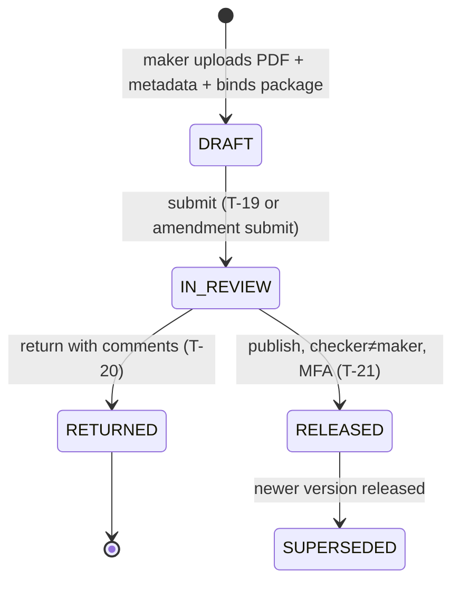

# Files and report management

**Status:** Approved at gates G1 and G2 (2026-11-25).

## 1. Upload pipeline (all file types)
1. The client requests an upload URL (`purpose`, declared type, size). The API checks the role, size limit and type allow-list, creates `file_object` (`PENDING`), and returns a **pre-signed S3 PUT** to `quarantine/<purpose>/<uuid>` (15 min, content-length and content-type conditions).
2. The client uploads straight to S3. Files never pass through the app servers.
3. **Malware scan** (GuardDuty Malware Protection for S3 on the quarantine prefix, ADR-010). The result event → `lc-files` queue.
4. The worker validates: magic-byte type matches the allow-list; for PDFs, it parses with a hardened library (rejects encrypted, corrupt, or JavaScript-bearing PDFs); for images, it strips EXIF and re-encodes; it computes SHA-256.
5. Clean → copy to `clean/<purpose>/<uuid>` (SSE-KMS) and set `scan_status=CLEAN` with `sha256`. Otherwise `INFECTED` or `REJECTED`, kept in quarantine with a 30-day lifecycle, and the user is notified.
6. Only `CLEAN` files can be referenced by domain commands (`FILE_NOT_CLEAN` otherwise).

| Purpose | Types | Max size |
|---|---|---|
| REPORT_ORIGINAL | PDF | 20 MB |
| RECEIPT_PHOTO | JPEG, PNG, HEIC→JPEG | 10 MB each, ≤ 10 per receipt |
| BOOKING_ATTACHMENT | PDF, JPEG, PNG, XLSX, DOCX | 25 MB in total |
| KYC_DOCUMENT | PDF, JPEG, PNG | 10 MB |
| DISPUTE_EVIDENCE | PDF, JPEG, PNG | 10 MB each |
| IMPORT_SOURCE | CSV, XLSX | 50 MB |

In the API contract (`components/schemas/files.yaml`) every upload request has one shape, `{fileName?, contentType, sizeBytes}`, narrowed per purpose to the types and size of this table, and every upload answer has one shape, `{fileId, uploadUrl, method: "PUT", headers, expiresAt}`. The client sends the PUT with exactly the returned `headers`, because the content type and length are conditions of the signature.

## 2. Downloads
- Only through `POST …/download-url`, which checks permission, writes `report_access_log` (for reports), and returns a **15-minute pre-signed GET** with `Content-Disposition: attachment`. The answer is always `{downloadUrl, expiresAt}`; a report download adds `copy` (`STAMPED` or `ORIGINAL`).
- Buckets: Block Public Access on. Bucket policy denies non-TLS. Versioning on. Object Lock (governance) for `REPORT_*` and `FINANCIAL_DOCUMENT` prefixes, for the retention period (to be confirmed with legal review).

## 3. Report lifecycle

A returned version stays RETURNED. The Maker creates a **new** DRAFT version (history is preserved, EC-52).

### Stamping and release (ADR-014)
Stamping happens at **submission**, not at publication. Publication is then a single synchronous transaction.
1. On submit (T-19, or an amendment submit), the worker generates `verification_code` (≥ 80 random bits, Crockford base32, 16 chars) and builds the report QR → `https://<public-host>/v/<verification_code>`.
2. It **stamps a copy**: the QR plus a small footer ("Verify at … · <code>") on page 1 (position configurable per lab, default bottom-right, with a fallback to an appended final page if there isn't enough space). **The original is never modified.** It computes `stamped_sha256` and stores the copy as `REPORT_STAMPED`.
3. The Checker reviews the **stamped** copy (what the customer will get). `publish` is blocked until the stamp job has finished (`stamped_file_id` set).
4. Publish (T-21) in one transaction: version → RELEASED, previous RELEASED → SUPERSEDED, booking → REPORT_RELEASED, timer, outbox.
5. Until release, `/v/<code>` returns **Not found**, so a code leaked during review proves nothing.
6. If stamping fails, the job retries and Ops is alerted. The Maker can still see the version as "Preparing for review".

### Amendment (FR-RPT-09)
The Maker creates version n+1 with `amendment_reason` (required), binds it to the same booking's package, submits it, and the Checker publishes. The booking state doesn't change. The customer is notified. Verification of vn shows "Superseded by v(n+1)".

## 4. Sharing
`report_share_link`: a random 256-bit token (only the hash is stored), default expiry 7 days (maximum 30), revocable, with an access counter. Resolving a link gives a 15-minute download URL for the **stamped** copy only. Access is logged.

## 5. Ops access
Platform roles see report **metadata only**. File access goes through break-glass (requested by `PLATFORM_OPS` with a dispute reference, approved by `PLATFORM_ADMIN`, valid 24 h), logged in `report_access_log` with `BREAK_GLASS`.

## 6. As built (P3-06)

Code: `packages/core/src/files/` (framework-free; depends only on `platform`), the consumer in `packages/core/src/platform/queue-consumer.ts`, Nest wiring in `apps/api/src/modules/files/` and `apps/worker/src/modules/files/`. **No HTTP route exists yet**: the upload and download endpoints belong to the modules that own the thing a file is attached to, because they must decide first whether the caller may (TENANT_ISOLATION rule 8), with the guards of P3-04. They call `FileService` in their own transaction and presign after it commits.

**Status flow** (`file_object.scan_status`, OQ-115). `PENDING` (row created, key `quarantine/<PURPOSE>/<fileId>`, ids only) → scan result → `CLEAN` (validated, hashed, copied to `clean/<PURPOSE>/<fileId>`, the quarantine object deleted), `INFECTED` or `REJECTED` (reason codes in `validation_errors`, object kept in quarantine for the 30-day lifecycle), or `ERROR` (scan did not complete; a later result may still decide it). `CLEAN`, `INFECTED` and `REJECTED` are final: the trigger `trg_file_object_frozen` (migration `20261125110000_file_object_frozen`) refuses any change to the stored object or the outcome, and only the scan job (system context) may change them at all. That migration is the one schema change; it is why a released report's file cannot be rewritten even by a faulty module. A report version still has to bind only `CLEAN` files (`FileService.requireClean(tx, id, purposes)`, which answers `FILE_NOT_CLEAN`) and must never offer to replace the file of a released version.

**Order of work and transactions.** No S3 call is made inside a database transaction. Upload: `requestUpload(tx, ...)` validates the purpose's type and size and inserts the row; commit; `presignUpload(ticket)` returns the contract's `FileUploadUrl` (`fileId`, `uploadUrl`, `method: "PUT"`, `headers`, `expiresAt`; 15 minutes; `Content-Type` and `Content-Length` are signed). Scan result (`FileScanProcessor.handle`): read the file's facts; with no transaction `head`, size check, read pinned to the etag, validate (size equals declared, magic bytes equal the declared type, every PDF structurally valid, no Office macros), SHA-256, and only then copy to the clean prefix pinned to the same etag (so a re-upload through the still-valid URL cannot swap the bytes); then one transaction with `processOnce` on the event id, a compare-and-set status update, the audit entry `file.scan_completed` and the outbox event (`file.available` or `file.rejected`, OQ-120); then delete the quarantine object. Every step can be repeated, so a failure is left to redelivery. Download: `requestDownload(tx, ...)` finds the file through row-level security, requires `CLEAN` (otherwise `NOT_FOUND`), audits Restricted purposes (OQ-121) and returns a ticket; `presignDownload(ticket)` gives the 15-minute GET with `Content-Disposition: attachment`. A file the caller cannot see and a file that is not `CLEAN` both answer `NOT_FOUND`. The owning module decides who may download.

**Queue and worker.** `QueueConsumer` (port, SQS and in-memory implementations) and `consumeBatch` are generic: a message is acknowledged only after its handler returns, a failure leaves it for redelivery. `consumeFilesQueue` handles `file.scan_result` messages from `lc-files` and leaves any other type undeleted. The worker runs it every 2 s (`FILES_POLL_INTERVAL_MS`) when `QUEUE_URL_LC_FILES`, `FILES_BUCKET` and `WORKER_DATABASE_URL` are set.

**Scanner.** `FILES_SCANNER=guardduty` (the default, and the only value allowed in production) or `fake` (`FakeMalwareScanner`: clean unless the object contains `FAKE_INFECTED_MARKER`; development and test only). `fake` with any `NODE_ENV` other than `development` or `test` makes `readFilesWorkerConfig` throw, so the worker does not start; `FILES_DEV_AUTO_SCAN=true` alone selects `fake` and is refused the same way; `FILES_DEV_AUTO_SCAN=true` with `FILES_SCANNER=guardduty` is a contradiction and throws. With `guardduty` the consumer accepts GuardDuty results only: the platform's own `file.scan_result` envelope is left on the queue (nothing but GuardDuty can mark a file clean in production). With `fake` both are accepted. `FILES_DEV_AUTO_SCAN=true` makes the worker scan `PENDING` uploads with the fake scanner and feed the verdict through the same processor.

**GuardDuty Malware Protection for S3** (ADR-010, OQ-116; `packages/core/src/files/guardduty.ts`). Documentation read on 2026-11-25: https://docs.aws.amazon.com/guardduty/latest/ug/monitor-with-eventbridge-s3-malware-protection.html (EventBridge event, "S3 object scan result") and https://docs.aws.amazon.com/guardduty/latest/ug/monitoring-malware-protection-s3-scans-gdu.html (scan status and result status values). GuardDuty scans an object when it is created in the protected bucket and publishes to the default EventBridge bus of the account: `source` `aws.guardduty`, `detail-type` `GuardDuty Malware Protection Object Scan Result`, `detail` with `schemaVersion` `1.0`, `scanStatus`, `resourceType` `S3_OBJECT`, `s3ObjectDetails` (`bucketName`, `objectKey`, `eTag`, `versionId`, `s3Throttled`) and `scanResultDetails` (`scanResultStatus`, `threats`, `statusReasons`). Mapping, the only one: `scanStatus` `COMPLETED` with `NO_THREATS_FOUND` is `CLEAN`; `COMPLETED` with `THREATS_FOUND` is `INFECTED`; `SKIPPED` with `UNSUPPORTED` or `ACCESS_DENIED`, and `FAILED` with `FAILED`, are `ERROR` (the file can still be decided by a later result, OQ-115). An event that is not this structure, has a value outside these, or contradicts itself (a scan status with a result status it does not allow, `NO_THREATS_FOUND` with a threat) is rejected: the consumer throws, the message is not deleted and ends in the dead-letter queue. An unknown value is never clean. Only events for `FILES_BUCKET` and keys under the quarantine prefix whose last segment is a file id are used; any other well-formed event is acknowledged and counted (`GuardDutyMalwareScanner.ignored`). **The verdict is bound to the scanned object**: the message carries the event's bucket, key, ETag and version id, and the processor compares them with the object it reads (`head`) before it reads or copies: a different key, ETag (compared without quotes) or version id means the object was replaced after the scan, the verdict does not apply and the file becomes `ERROR`, nothing is promoted; the replacement is scanned by GuardDuty on its own and that result decides. An `INFECTED` verdict is applied regardless (fail safe, OQ-168). The EventBridge event `id` is the idempotency key for `processOnce` (a non-UUID id falls back to a deterministic id), so EventBridge's at-least-once delivery is safe.

*Delivery path and rule (documentation only; the infrastructure is P3-11).* EventBridge default bus → rule → SQS `lc-files`, with **no input transformer** (the queue body must be the event itself, and the consumer tells it from the platform envelope by `source`). The queue policy must allow `events.amazonaws.com` to `sqs:SendMessage` for that rule's ARN. Event pattern, from the documentation, narrowed to the platform's bucket: `{ "source": ["aws.guardduty"], "detail-type": ["GuardDuty Malware Protection Object Scan Result"], "detail": { "s3ObjectDetails": { "bucketName": ["<FILES_BUCKET>"] } } }`. The Malware Protection plan must be on the bucket with an object prefix filter for the quarantine prefix and EventBridge delivery enabled (the documentation's `EVENTBRIDGE_MANAGED_EVENTS_DELIVERY_DISABLED` status reason is the error when it is not). The optional S3 object tag is not used.

**Images** (`packages/core/src/files/images.ts`, `sharp`, OQ-118, OQ-165 to OQ-167). For JPEG and PNG, after a clean verdict and the magic-byte check, the processor decodes and re-encodes the image as a new JPEG (quality 90) or PNG: EXIF orientation is applied to the pixels first, then no metadata is written (no EXIF or GPS, XMP, IPTC, text chunks, thumbnails or ICC profile). Limits: at most 50 million pixels and 16 384 px a side on input, checked from the header before decoding (`IMAGE_TOO_LARGE`); output scaled down to fit 8 192 px, never up; animated or multi-frame images refused (`IMAGE_ANIMATED`); a file the decoder cannot read, or that decodes as another format than its magic bytes, is `IMAGE_INVALID`. **The stored object is the re-encoded one** (written with `ObjectStorage.putObject` instead of `copy`, same SSE-KMS), and **an image's stored SHA-256 is not the hash of what the user uploaded**: `file_object.sha256` and `size_bytes` are those of the stored bytes, written once at the `CLEAN` transition together with the key (the frozen-columns trigger is unchanged). The declared-size check is unchanged (the uploaded object must still be the declared size); the audit entry and the outbox event of a re-encoded image say so (`reencoded: true`, `storedSizeBytes`, and in the audit entry `uploadedSizeBytes`). The quarantine original is deleted after the commit, as for every type. The encoder is deterministic, so a redelivery stores the same bytes the first delivery hashed. **HEIC is refused** after the scan with `IMAGE_FORMAT_UNSUPPORTED`: sharp's prebuilt libvips decodes AVIF only, not HEVC (OQ-167). `sharp` has no install script, so it needs no `allowBuilds` entry; it is configured with its cache off and 2 threads.

**First HTTP use (I1-LAB-03, I1-LAB-04: the lab claim letterhead).** `POST /v1/lab/claims/{id}/manual/upload-url` calls `FileService.requestUpload` in a `system` transaction (`LabClaimsService`) and `presignUpload` after the commit; `POST /v1/lab/claims/{id}/manual` binds the file with `requireClean`. What is new for files: (1) the purpose is `KYC_DOCUMENT` (no purpose exists for a claim letterhead and a new enum value would be a schema change, OQ-213), so the 10 MB and PDF, JPEG, PNG rule and the audited downloads (OQ-121) apply; (2) **an ownerless file**: `owner_org_id`, `customer_org_id` and `lab_org_id` are NULL because the claimant belongs to no organisation, and the claimed organisation must not own or see it; the policy `file_visibility` then lets only the platform and the system read it, and only they insert it, hence the `system` context; (3) the binding to the thing a file belongs to is a `file_link` row (entity `lab_claim_request`, role `CLAIM_LETTERHEAD`) written with the upload request, because `file_object` itself says nothing of the claim, and the submit looks the file up by id + uploader + purpose + no owner + that link, so a file of another claim, user or purpose is `404` however its id was obtained; (4) a file name is stored sanitised in `original_filename` as before, and stays out of the audit rows, outbox events, logs and answers of the claim (OQ-216); (5) the first caller that receives `FILE_NOT_CLEAN` for a user-facing action: the claim does not move and the client retries after the scan (there is still no status read, OQ-49, OQ-215). No download endpoint exists for it: Ops reaches it later through the platform context.

**First download over HTTP (I2-ADM-04: the claim letterhead, `POST /v1/admin/claims/{id}/letterhead/download-url`).** The module checks who may and which file (the claim's own letterhead, see AUTHENTICATION section 5), then calls `FileService.requireClean` (so a pending, infected, rejected or errored file answers `422 FILE_NOT_CLEAN`, not the `404` that `requestDownload` gives on its own) and `requestDownload(tx, ...)` in the same transaction (the restricted purpose `KYC_DOCUMENT` writes `file.download_url`, and the module adds `lab_claim.letterhead_download_url_created` with the claim, the file and the reviewer); after the commit `presignDownload(ticket)` makes the 15-minute `Content-Disposition: attachment` GET, which is returned as `FileDownloadUrl` and nowhere else. The in-memory storage of the tests records each presigned GET, so the tests prove the URL is made once, after the commit, for the right key.

**Not done or different from the text above.** Other HTTP endpoints (they come with the feature increments); HEIC to JPEG (OQ-167); the EventBridge rule, queue policy and staging check of GuardDuty (P3-11, OQ-168, OQ-169); a PDF library (a hand-written check stands in, OQ-117, deferred to report stamping); retention classes and Object Lock (OQ-119); a sweep of abandoned uploads (OQ-123); per-receipt and per-booking limits (OQ-124). The S3 adapter is tested with real presigning against a local client and a stubbed `send`, not against LocalStack.
