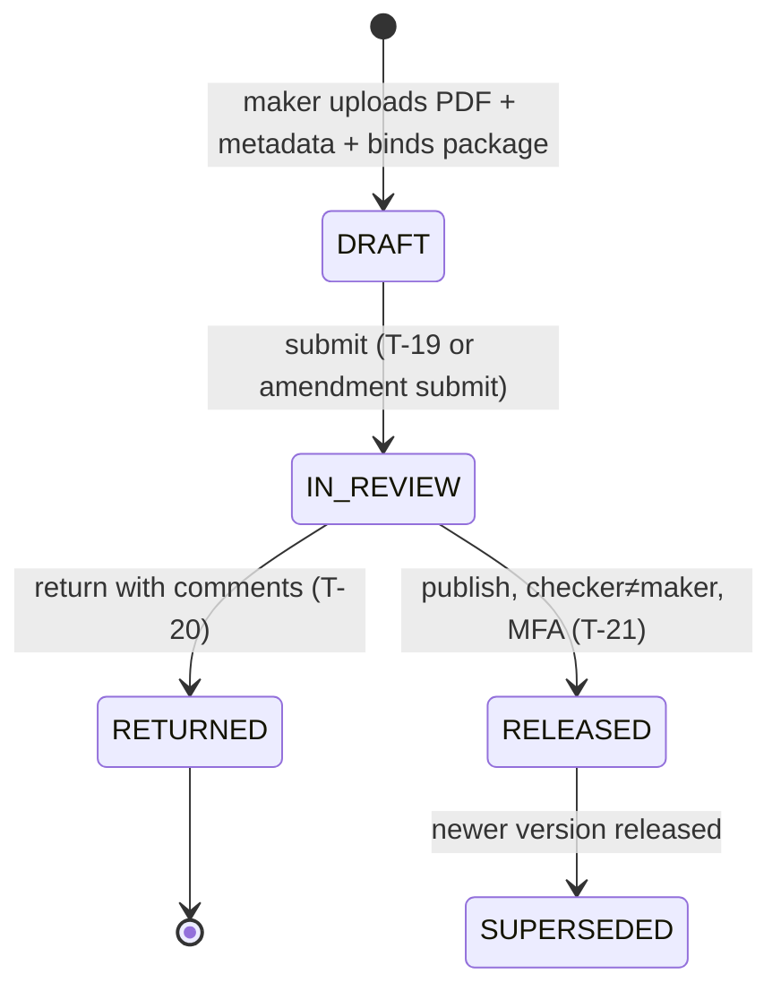

# Files and report management

**Status:** DRAFT for gate G1/G2.

## 1. Upload pipeline (all file types)
1. The client requests an upload URL (`purpose`, declared type, size). The API checks the role, size limit and type allow-list, creates `file_object` (`PENDING`), and returns a **pre-signed S3 PUT** to `quarantine/<purpose>/<uuid>` (15 min, content-length and content-type conditions).
2. The client uploads straight to S3. Files never pass through the app servers.
3. **Malware scan** (GuardDuty Malware Protection for S3 on the quarantine prefix, ADR-010). The result event → `lc-files` queue.
4. The worker validates: magic-byte type matches the allow-list; for PDFs, it parses with a hardened library (rejects encrypted, corrupt, or JavaScript-bearing PDFs); for images, it strips EXIF and re-encodes; it computes SHA-256.
5. Clean → copy to `clean/<purpose>/<uuid>` (SSE-KMS) and set `scan_status=CLEAN` with `sha256`. Otherwise `INFECTED` or `REJECTED`, kept in quarantine with a 30-day lifecycle, and the user is notified.
6. Only `CLEAN` files can be referenced by domain commands (`FILE_NOT_CLEAN` otherwise).

| Purpose | Types | Max size |
|---|---|---|
| REPORT_ORIGINAL | PDF | 20 MB |
| RECEIPT_PHOTO | JPEG, PNG, HEIC→JPEG | 10 MB each, ≤ 10 per receipt |
| BOOKING_ATTACHMENT | PDF, JPEG, PNG, XLSX, DOCX | 25 MB in total |
| KYC_DOCUMENT | PDF, JPEG, PNG | 10 MB |
| DISPUTE_EVIDENCE | PDF, JPEG, PNG | 10 MB each |
| IMPORT_SOURCE | CSV, XLSX | 50 MB |

## 2. Downloads
- Only through `POST …/download-url`, which checks permission, writes `report_access_log` (for reports), and returns a **15-minute pre-signed GET** with `Content-Disposition: attachment`.
- Buckets: Block Public Access on. Bucket policy denies non-TLS. Versioning on. Object Lock (governance) for `REPORT_*` and `FINANCIAL_DOCUMENT` prefixes, for the retention period (to be confirmed with legal review).

## 3. Report lifecycle

A returned version stays RETURNED. The Maker creates a **new** DRAFT version (history is preserved, EC-52).

### Stamping and release (ADR-014)
Stamping happens at **submission**, not at publication. Publication is then a single synchronous transaction.
1. On submit (T-19, or an amendment submit), the worker generates `verification_code` (≥ 80 random bits, Crockford base32, 16 chars) and builds the report QR → `https://<public-host>/v/<verification_code>`.
2. It **stamps a copy**: the QR plus a small footer ("Verify at … · <code>") on page 1 (position configurable per lab, default bottom-right, with a fallback to an appended final page if there isn't enough space). **The original is never modified.** It computes `stamped_sha256` and stores the copy as `REPORT_STAMPED`.
3. The Checker reviews the **stamped** copy (what the customer will get). `publish` is blocked until the stamp job has finished (`stamped_file_id` set).
4. Publish (T-21) in one transaction: version → RELEASED, previous RELEASED → SUPERSEDED, booking → REPORT_RELEASED, timer, outbox.
5. Until release, `/v/<code>` returns **Not found**, so a code leaked during review proves nothing.
6. If stamping fails, the job retries and Ops is alerted. The Maker can still see the version as "Preparing for review".

### Amendment (FR-RPT-09)
The Maker creates version n+1 with `amendment_reason` (required), binds it to the same booking's package, submits it, and the Checker publishes. The booking state doesn't change. The customer is notified. Verification of vn shows "Superseded by v(n+1)".

## 4. Sharing
`report_share_link`: a random 256-bit token (only the hash is stored), default expiry 7 days (maximum 30), revocable, with an access counter. Resolving a link gives a 15-minute download URL for the **stamped** copy only. Access is logged.

## 5. Ops access
Platform roles see report **metadata only**. File access goes through break-glass (requested by `PLATFORM_OPS` with a dispute reference, approved by `PLATFORM_ADMIN`, valid 24 h), logged in `report_access_log` with `BREAK_GLASS`.
