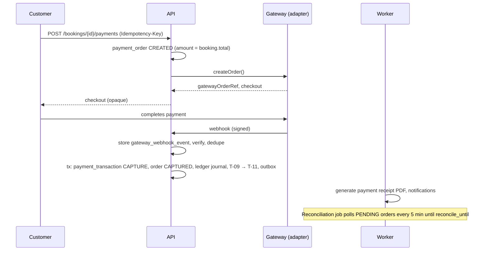

# Payments, refunds, payouts and ledger

**Status:** Approved at gates G1 and G2 (2026-11-25). The ledger chart of accounts needs Finance review (OQ-08).

## 1. Money rules
- Integer paise everywhere: `bigint` in the database and in TypeScript domain code. JSON carries `amountPaise` as a number, because realistic values are far below 2^53. A lint rule forbids floating-point arithmetic on money.
- GST per line: `round_half_up(taxable × rate_bp / 10000)`. Booking GST = Σ line GST. CGST/SGST vs IGST is split on the financial document using place of supply (lab site state vs. recipient state).
- The platform fee is always 0 in the MVP (CD-05). The code path exists and is tested with 0.

## 2. Payment flow

## 3. Ledger postings (proposal)

| Event | Debit | Credit |
|---|---|---|
| Payment captured (₹T) | `GATEWAY_CLEARING` T | `CUSTOMER_PREPAYMENT[customer]` T |
| Lab service delivered (at REPORT_RELEASED) | `CUSTOMER_PREPAYMENT` T | `LAB_PAYABLE[lab]` (T − platform fee) + `PLATFORM_FEE_REVENUE` (0) |
| Refund issued before delivery (₹R) | `CUSTOMER_PREPAYMENT` R | `GATEWAY_CLEARING` R |
| Cancellation or no-show fee kept (₹F) | `CUSTOMER_PREPAYMENT` F | `LAB_PAYABLE[lab]` F × lab_share + `PLATFORM_FEE_REVENUE` F × (1 − lab_share) |
| Gateway settlement received | `BANK` (future) | `GATEWAY_CLEARING` |
| Payout released (₹P) | `LAB_PAYABLE[lab]` P | `PAYOUT_CLEARING` / `BANK` P |
| Post-delivery dispute refund (₹R) | `LAB_PAYABLE[lab]` R (if before payout) | `GATEWAY_CLEARING` R |

Gateway fees: recorded from the settlement report once the format is known (OQ-01). Who bears them is a policy item (OQ-08).

Invariants (tested): every journal balances; Σ `CUSTOMER_PREPAYMENT[customer, booking]` ≥ 0; Σ refunds ≤ captured; a booking is in at most one non-cancelled payout.

## 4. Refund policy by stage
See `01-product/BUSINESS_RULES.md` BR-070..BR-076. Refunds go to the original method through `PaymentGateway.refund()`. Refunds above a configurable amount (`refund.approval_threshold_paise`) need `PLATFORM_FINANCE` approval. Each refund generates a **refund note**, and, if an invoice was already issued, a **credit note**.

## 5. Payout lifecycle
1. At REPORT_RELEASED, the engine schedules `DISPUTE_WINDOW_END` (72 h).
2. When it fires: if there's no open dispute and no `payout_hold`, the booking moves to COMPLETED and a `payout_item` is added to the lab's PENDING payout batch (daily batching per lab org and bank account).
3. The batch becomes `ELIGIBLE`. `PLATFORM_FINANCE` releases it (step-up MFA) via the mechanism chosen in ADR-009. Interim: export the payout file and release manually, then record the UTR.
4. A dispute moves the booking to DISPUTED and places a hold. On decision: refund (partial or full) and/or release.

## 6. Financial documents (issuers pending OQ-08)
| Document | When | Proposed issuer |
|---|---|---|
| Payment receipt | Payment captured | Platform (acknowledgement of payment, not a tax invoice) |
| Tax invoice (testing services) | Report released, or on payment (policy to be decided) | Lab (platform generates it on the lab's behalf using the lab GSTIN) |
| Credit note | Refund after the invoice | Same as the invoice issuer |
| Refund note | Any refund | Platform |

Numbers are gapless per issuer, document type and financial year (`document_series`). PDFs are rendered by the worker, hashed and stored as `FINANCIAL_DOCUMENT`. Documents are immutable. Corrections are made through credit notes.

## 7. As built (P3-09)

What exists after P3-09: the gateway-neutral interface, the fake gateway, webhook intake, notification processing and the start of a payment. No real gateway adapter exists and none is assumed (OQ-01). Code is in `packages/core/src/payments/`; the HTTP and worker wiring is in `apps/api/src/modules/payments/` and `apps/worker/src/modules/payments/`. Open points are OQ-125 to OQ-134.

- **`PaymentGateway`** (`gateway.ts`) has `code`, `capabilities`, `createOrder`, `verifyAndParseWebhook`, `parseVerifiedWebhookBody` (OQ-125), `fetchStatus`, `refund` and the optional `payouts` and `parseSettlementReport`. Each member names the document section that needs it. Capability flags default to `false` (`DEFAULT_GATEWAY_CAPABILITIES`); callers read them and never assume split or delayed settlement or a payout API. `payouts` is a marker that stays `null` until OQ-02 settles its shape.
- **`FakePaymentGateway`** (`fake-gateway.ts`) is deterministic (counters, an injected `Clock`) and keeps its sessions in memory. Its notifications are signed with its own scheme: hex HMAC-SHA256 over `<timestamp>.<body bytes>`, headers `x-fake-signature` and `x-fake-timestamp`, a 300-second replay window. Test drivers: `completePayment`, `failPayment`, `expirePayment`, `buildNotification` (any event, repeated ids, unknown reference, wrong amount, another currency), `signBody`, `failNextCreateOrder`. It cannot be selected in production: `selectGatewayCode` allows it when `APP_ENV` is not `production` and, if `NODE_ENV=production`, only with `APP_ENV=uat` (OQ-133). `PAYMENT_GATEWAY` must be `fake`; any other value stops the API and the worker at start-up.
- **Intake** (`recordGatewayEvent`): the adapter verifies the signature; the raw body is stored encrypted and hashed, one `gateway_webhook_event` row per event, `ON CONFLICT (gateway, event_id) DO NOTHING`, so a duplicate (also two at once) is stored once. A notification that does not verify is stored once per body hash as untrusted (`signature_valid = false`, `IGNORED`) and never processed. Authentic rows are `RECEIVED` and raise `payment.gateway_event_received`. Intake changes no payment order and no booking. The controller answers 200, empty, only after the transaction commits, and answers the same for a forged, a duplicate and an unknown-reference notification; if the row cannot be stored it answers 500 so the gateway retries.
- **Processing** (`processGatewayEvent`, run by the worker's `payment-events` job): the row is locked (`FOR UPDATE`), only a `RECEIVED` row is processed, and the result is written in the same transaction, so a notification is applied exactly once. The order is matched by `merchantReference` (our payment order id) and gateway. A failure or expiry closes an open attempt, otherwise it is ignored (out of order). A capture must be INR and exactly the order's amount, which is the booking total. An exact first capture of a payable attempt marks it `CAPTURED`, writes the `payment_transaction` and, if the booking is `ACCEPTED`, runs T-09 through `BookingEngine.transitionIfStatus` with actor `{ kind: 'SYSTEM', source: 'PAYMENTS' }`. Everything else is the exception path (OQ-127): row `FAILED` with a code, an audit row and `payment.exception_raised` with a `recommendedAction`. Nothing is refunded (OQ-128). A transient error (a frozen booking, the database) rolls back and leaves the row `RECEIVED` for the next pass.
- **How payments reaches the booking.** Only through the engine's transition function (rule 4). `payments` may depend on `booking`; `booking` never imports `payments` (rule 3, `.dependency-cruiser.cjs`). The `hasPendingPayment` port the booking timer handler asks for is `createHasPendingPayment` (OQ-100, OQ-130). `registerPaymentBookingGuards` adds the T-09 guard to the registry the app gives the engine: T-09 is refused unless the command names an order of the booking that is `CAPTURED` for exactly the booking total.
- **Starting a payment** (`PaymentService.createAttempt`, then `openCheckout`): the first inserts the attempt in `CREATED` for the booking's stored total (booking `ACCEPTED`, inside `payment_due_at`, not frozen; the caller must be a user of the booking's customer organisation, taken from the database context), the second asks the gateway and moves it to `PENDING`. They are separate transactions so no gateway call runs inside one. Which role may pay is the permission guard's job (P3-04, OQ-134).
- **HTTP.** Implemented: `receivePaymentWebhook` (`POST /v1/webhooks/payments/{gateway}`; a gateway that is not enabled is 404). Not implemented, waiting for the P3-04 guards: `createPaymentOrder`, `listPaymentOrders`, `getPaymentReturnStatus`. The body parsers skip `/v1/webhooks/*` (`app.config.ts`) so the route reads the exact bytes and a body that is not JSON is still stored.
- **Not built** (OQ-129, OQ-130): ledger journal and receipt on T-09, T-11, the `PAYMENT_RECONCILE` timer and polling, refunds, payouts, settlement reports. Gateway fees and platform fees do not appear (the platform fee stays 0).
- **Environment**: `PAYMENT_GATEWAY`, `PAYMENT_FAKE_WEBHOOK_SECRET`, `PAYMENT_PAYLOAD_ENCRYPTION_KEY`, `PAYMENT_EVENTS_POLL_INTERVAL_MS`, `PAYMENT_EVENTS_BATCH_SIZE` (`.env.example`).
