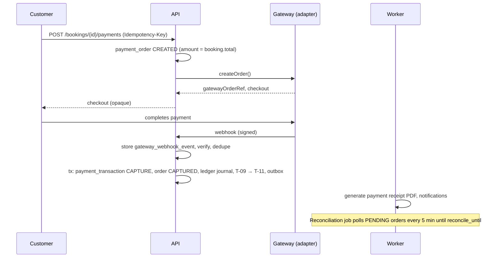

# Payments, refunds, payouts and ledger

**Status:** DRAFT for gate G1/G2. The ledger chart of accounts needs Finance review (OQ-08).

## 1. Money rules
- Integer paise everywhere: `bigint` in the database and in TypeScript domain code. JSON carries `amountPaise` as a number, because realistic values are far below 2^53. A lint rule forbids floating-point arithmetic on money.
- GST per line: `round_half_up(taxable × rate_bp / 10000)`. Booking GST = Σ line GST. CGST/SGST vs IGST is split on the financial document using place of supply (lab site state vs. recipient state).
- The platform fee is always 0 in the MVP (CD-05). The code path exists and is tested with 0.

## 2. Payment flow

## 3. Ledger postings (proposal)

| Event | Debit | Credit |
|---|---|---|
| Payment captured (₹T) | `GATEWAY_CLEARING` T | `CUSTOMER_PREPAYMENT[customer]` T |
| Lab service delivered (at REPORT_RELEASED) | `CUSTOMER_PREPAYMENT` T | `LAB_PAYABLE[lab]` (T − platform fee) + `PLATFORM_FEE_REVENUE` (0) |
| Refund issued before delivery (₹R) | `CUSTOMER_PREPAYMENT` R | `GATEWAY_CLEARING` R |
| Cancellation or no-show fee kept (₹F) | `CUSTOMER_PREPAYMENT` F | `LAB_PAYABLE[lab]` F × lab_share + `PLATFORM_FEE_REVENUE` F × (1 − lab_share) |
| Gateway settlement received | `BANK` (future) | `GATEWAY_CLEARING` |
| Payout released (₹P) | `LAB_PAYABLE[lab]` P | `PAYOUT_CLEARING` / `BANK` P |
| Post-delivery dispute refund (₹R) | `LAB_PAYABLE[lab]` R (if before payout) | `GATEWAY_CLEARING` R |

Gateway fees: recorded from the settlement report once the format is known (OQ-01). Who bears them is a policy item (OQ-08).

Invariants (tested): every journal balances; Σ `CUSTOMER_PREPAYMENT[customer, booking]` ≥ 0; Σ refunds ≤ captured; a booking is in at most one non-cancelled payout.

## 4. Refund policy by stage
See `01-product/BUSINESS_RULES.md` BR-070..BR-076. Refunds go to the original method through `PaymentGateway.refund()`. Refunds above a configurable amount (`refund.approval_threshold_paise`) need `PLATFORM_FINANCE` approval. Each refund generates a **refund note**, and, if an invoice was already issued, a **credit note**.

## 5. Payout lifecycle
1. At REPORT_RELEASED, the engine schedules `DISPUTE_WINDOW_END` (72 h).
2. When it fires: if there's no open dispute and no `payout_hold`, the booking moves to COMPLETED and a `payout_item` is added to the lab's PENDING payout batch (daily batching per lab org and bank account).
3. The batch becomes `ELIGIBLE`. `PLATFORM_FINANCE` releases it (step-up MFA) via the mechanism chosen in ADR-009. Interim: export the payout file and release manually, then record the UTR.
4. A dispute moves the booking to DISPUTED and places a hold. On decision: refund (partial or full) and/or release.

## 6. Financial documents (issuers pending OQ-08)
| Document | When | Proposed issuer |
|---|---|---|
| Payment receipt | Payment captured | Platform (acknowledgement of payment, not a tax invoice) |
| Tax invoice (testing services) | Report released, or on payment (policy to be decided) | Lab (platform generates it on the lab's behalf using the lab GSTIN) |
| Credit note | Refund after the invoice | Same as the invoice issuer |
| Refund note | Any refund | Platform |

Numbers are gapless per issuer, document type and financial year (`document_series`). PDFs are rendered by the worker, hashed and stored as `FINANCIAL_DOCUMENT`. Documents are immutable. Corrections are made through credit notes.
